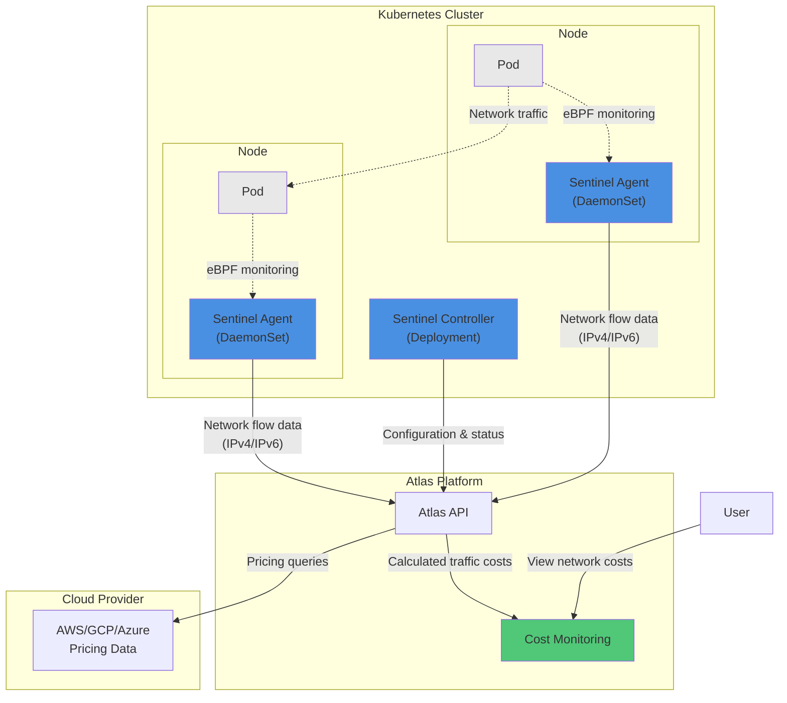

# Network cost

The network cost feature enables you to delve deeper into the distribution of traffic across your cluster, namespaces, and workloads and provides insights into the associated costs.

## Feature overview

The network cost feature enables you to delve deeper into the distribution of traffic across your cluster and workloads, providing insights into the associated costs. With this feature, you can analyze how traffic is spread among your various workloads and gain a better understanding of the expenses incurred.

You will find details on egress, ingress network traffic, and costs, as well as a breakdown of intra-AZ and cross-AZ traffic patterns. This monitoring supports all network configurations, including both IPv4 and IPv6 clusters, ensuring complete visibility regardless of your IP addressing architecture. Refer to the glossary for an understanding of the meanings of these network traffic dimensions.

## How it works



Atlas utilizes the [Sentinel](sentinel.md) agent to identify in-cluster traffic across both IPv4 and IPv6 networks. You can easily install this service in your cluster by following the instructions provided on the Network cost tab.

Once installed, Sentinel collects traffic data from all IP communications using eBPF technology and sends it to Atlas for analysis. Based on this data, Atlas automatically determines the appropriate pricing based on your cloud provider.

By tracking both ingress and egress traffic across all IP protocols, Atlas provides you with comprehensive visibility into your overall traffic patterns. This comprehensive monitoring ensures that your cost analysis remains accurate, regardless of whether your infrastructure uses IPv4, IPv6, or dual-stack configurations.

Additionally, detailed information about InterZone and IntraZone traffic, including the amount of transferred data and its corresponding price, is available. This allows you to view the traffic within your cluster and gain insights into its distribution among your various workloads. You can check traffic per day and observe how it changes over time.

You can also see traffic details within different dimensions, which are available in the `Cost monitoring` section.

### Network traffic monitoring setup

<Callout icon="📘" theme="info">
  ### Which upgrade method to use

  The Helm commands on this page use the **umbrella chart** (`atlas-helm/atlas`) by default. If you need to use a different method:

  - **[atlasctl](connect-with-atlasctl.md)**: To upgrade all Atlas components at once without managing Helm flags:
    ```shell
    atlasctl atlasware upgrade
    ```
    This preserves your existing configuration. See the [atlasctl documentation](connect-with-atlasctl.md) for installation and authentication instructions.
  - **Individual charts**: If you installed each component as a separate Helm release (e.g., for ArgoCD or custom GitOps), replace the release name and chart reference with the component-specific ones (e.g., `atlas-workload-autoscaler` and `atlas-helm/atlas-workload-autoscaler`) and remove the `autoscaler.atlas-workload-autoscaler.` value prefix.

  Not sure which method you used? Run `helm list -n atlas-agent`. A single release named `atlas` means umbrella chart; separate releases like `atlas-workload-autoscaler` mean individual charts.
</Callout>

<br />

To enable network cost monitoring with Sentinel, use the following Helm command:

```shell
helm upgrade atlas atlas-helm/atlas -n atlas-agent \
  --reset-then-reuse-values \
  --set autoscaler.atlas-sentinel.atlas.apiKey=<your-api-token> \
  --set autoscaler.atlas-sentinel.atlas.clusterID=<your-cluster-id> \
  --set autoscaler.atlas-sentinel.agent.enabled=true \
  --set autoscaler.atlas-sentinel.agent.extraArgs.netflow-enabled=true
```

> 📘 Important migration note
>
> If you have the `egressd` component running, it should be uninstalled before enabling network traffic monitoring in Sentinel:
>
> ```shell
> helm uninstall atlas-egressd -n atlas-agent 
> ```

For more detailed configuration options, see the [Sentinel configuration documentation](sec-configuring-sentinel.md#network-traffic-monitoring).

#### Workload network costs

<Image border={false} src="https://files.readme.io/59cd3db-image.png" />

In the workload network costs, you can analyze the destinations of the workload communication and review the corresponding workloads. To see the details, simply click "View details," and the details drawer will appear. Here, you can see all the destination information, traffic data, and costs of this data.

<Image border={false} src="https://files.readme.io/2609caf84989e746471ab9413568b6b69cac557f73b93aeb2c75e6b0e37c8423-image.png" />

#### Workload details page

<Image border={false} src="https://files.readme.io/124a263-image.png" />

On the Workload Details page, you can review the top five destinations with which your selected workload is communicating. To view more information about traffic, costs, and other destinations, click the arrow next to the Cross-AZ communication widget. This will show you a drawer with the full details.

#### Cluster network costs

<Image align="center" border={false} src="https://files.readme.io/5914d77-Screenshot_2023-08-18_at_10.50.17.png" />

#### Namespaces

<Image border={false} src="https://files.readme.io/92bf6b2-image.png" />

#### Allocation groups

<Image border={false} src="https://files.readme.io/08109f9-image.png" />

## Feature limitations

* Inter-region traffic has not been captured yet.
* Internet traffic is currently not being tracked.

## Glossary

* **Egress** refers to the outgoing network traffic flowing out of a network, system, or device. It represents the exit point for data packets or connections from a network to external destinations.
* **Ingress** refers to the incoming network traffic flowing into a network, system, or device. It represents the entry point for data packets or connections from external sources into a network.
* **Inter-Zone traffic** refers to network traffic that flows between different availability zones in a cloud region. Availability zones are physically separate data centers within a region that are designed to provide high availability and fault tolerance.
* **Intra-Zone traffic** refers to network traffic that flows within the same availability zone. It typically involves communication between resources (such as virtual machines or containers) within the same data center or availability zone.
* **Inter-Region traffic** refers to network traffic that flows between different cloud regions. Cloud providers have multiple regions distributed across different geographic locations. Inter-Region traffic involves communication between resources located in different regions, which can be in different countries or continents.
* **Internet traffic** refers to network traffic that flows between cloud resources and external networks or devices over the public internet.

<Cards columns={2}>
  <Card title="Storage cost monitoring" href="https://docs.atlas.example/docs/storage-cost-monitoring" icon="fa-hard-drive">
    Track Kubernetes storage costs across your clusters.
  </Card>
  <Card title="Cluster cost report" href="https://docs.atlas.example/docs/cluster-total-compute-cost" icon="fa-server">
    Detailed compute spend breakdown for a single cluster.
  </Card>
</Cards>