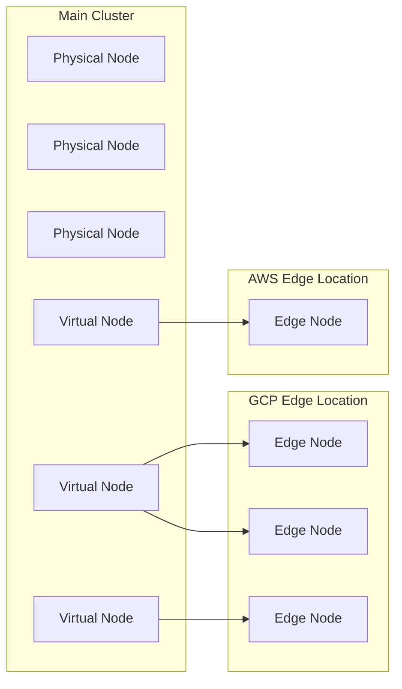

# Overview

# What is OMNI?

OMNI extends your Kubernetes cluster to additional regions and cloud providers, enabling you to provision nodes beyond your cluster's primary region. With OMNI, Atlas's Autoscaler can automatically select the most cost-effective location—whether in your main cluster region or configured edge locations—based on real-time pricing and instance availability.

## Key benefits

* **Expanded GPU access**: Address GPU scarcity by finding capacity across multiple regions and clouds when your main cluster region has limited availability. This is the primary use case for OMNI—unlocking GPU resources that would otherwise be unavailable.
* **Cost optimization across regions**: Autoscaler compares Spot and On-Demand prices across your main cluster region and edge locations, provisioning nodes where costs are lowest
* **Cross-region**: Extend EKS clusters to additional AWS regions or GKE clusters to additional GCP regions
* **Cross-cloud**: Extend EKS clusters to GCP regions or GKE clusters to AWS regions
* **Unified management**: Edge nodes appear as standard nodes in your cluster and are managed through already familiar Atlas workflows

## Supported configurations

**Cluster requirements:**

* Phase 2 cluster (Automation enabled)
* EKS or GKE or AKS
* GKE clusters must not have <Anchor label="intra-node visibility" target="_blank" href="https://docs.cloud.google.com/kubernetes-engine/docs/how-to/intranode-visibility">intra-node visibility</Anchor> enabled

**Edge locations:**

* Any AWS region (can be added to EKS or GKE or AKS clusters)
* Any GCP region (can be added to EKS or GKE or AKS clusters)
* Any OCI region (can be added to EKS or GKE or AKS clusters)

**Instance types:**

* Spot Instances
* On-Demand instances

**GPU support:**

* Automatic driver installation for GPU instances
* Support for NVIDIA GPUs across AWS, GCP, and OCI
* Future support planned for alternative cloud providers, extending the pool of available GPUs

# How OMNI works

OMNI introduces two core concepts:

**Edge location**: A cloud region where edge nodes can be provisioned. Each edge location contains the networking configuration and credentials needed to create nodes in that region. Edge locations are cluster-specific.

**Edge node**: A Kubernetes node running outside your cluster's control plane region. Edge nodes appear as virtual nodes in your cluster and can run workloads just like standard nodes.

This is a high-level overview of the entire OMNI flow from onboarding to provisioning:

1. You onboard your Phase 2 cluster to OMNI by deploying OMNI components
2. You create and configure edge locations in the regions where you want to provision nodes
3. You specify the edge locations in your node templates
4. Autoscaler provisions nodes in the most cost-effective location based on your node template constraints, comparing prices across the main cluster region and selected edge locations
5. Workloads can run on edge nodes in any configured edge location

## Architecture overview

The diagram below shows how edge nodes in different cloud regions appear as virtual nodes in your main cluster:



## Technical implementation

OMNI is powered by <Anchor label="Liqo" target="_blank" href="https://liqo.io/">Liqo</Anchor>, an open-source project that enables Kubernetes multi-cluster topologies. Liqo establishes peering connections between your main cluster and edge nodes, allowing them to appear as virtual nodes. You'll see Liqo components deployed in the `atlas-omni` namespace and Liqo-related labels on edge nodes (such as `liqo.io/type=virtual-node`).

## Connecting to workloads on edge nodes

To make a workload accessible from other workloads, you can expose it using a **Kubernetes Service**, as you would in any setup.

Using **Services**, you can establish connectivity between workloads that communicate:

* From the **Main Cluster** to an **Edge Cluster**
* From an **Edge Cluster** to the **Main Cluster**
* From an **Edge Cluster** to another **Edge Cluster**

Workloads connect to each other as they would in a cluster of traditional (non-edge) nodes, as long as you enable offloading for their namespace. OMNI reflects Services into edge clusters only for offloaded namespaces; pods on an edge node resolve main-cluster services over standard Kubernetes DNS. For the label keys and options, see <Anchor label="Scheduling workloads on edge nodes" target="_blank" href="doc:omni-getting-started#scheduling-workloads-on-edge-nodes">Scheduling workloads on edge nodes</Anchor> and <Anchor label="What the local-only label offloads" target="_blank" href="doc:omni-getting-started#what-the-local-only-label-offloads">What the local-only label offloads</Anchor>.

### Connection limitations

Currently, we don't support direct connectivity between edges. Consequently, if a workload on an edge needs to communicate with another one on a different edge, the traffic will always be forwarded through the main cluster. This approach may cause issues in multi-cluster scenarios where the edges are on other cloud providers than the main cluster, potentially leading to increased cloud networking costs.

### Networking cost considerations

When using edge locations, consider the networking cost implications based on your configuration:

| Scenario                           | Cost Impact      | Reason                                                 |
| ---------------------------------- | ---------------- | ------------------------------------------------------ |
| Same cloud, different region       | Moderate         | Cross-region data transfer fees apply                  |
| Different cloud providers          | High             | Cross-cloud egress fees can be significant             |
| Edge-to-edge (different locations) | High             | Traffic routes through main cluster, doubling the hops |
| Edge-to-main cluster               | Moderate to High | Depends on cloud providers and regions involved        |
| Main cluster only                  | Low              | No cross-region or cross-cloud fees                    |

## Prerequisites

In order to be able to provision nodes in the edge, your cluster must meet the following requirements:

* **Phase 2 cluster** — A cluster with Atlas automation enabled. Phase 2 clusters have the Cluster Controller, Evictor, and other automation components installed, allowing Atlas to provision and manage nodes. If your cluster is in Phase 1 (read-only), see <Anchor label="Legacy onboarding script reference" target="_blank" href="doc:legacy-onboarding-script">Legacy onboarding script reference</Anchor> for what gets created when adding automation.
* **Supported cloud service provider** — EKS, GKE, or AKS

### Required cloud permissions

OMNI needs permissions to create and manage resources in each edge location. The onboarding script automates most of this setup, but your cloud account must have permissions to:

**For AWS edge locations:**

* Create VPCs, subnets, internet gateways, and route tables
* Create and manage security groups
* Create IAM users and policies
* Launch EC2 instances

<Accordion title="AWS EC2 permissions" icon="fa-info-circle">
  ```
  The following EC2 permissions are required:

  * `ec2:DescribeAccountAttributes`
  * `ec2:DescribeAddresses`
  * `ec2:DescribeAvailabilityZones`
  * `ec2:DescribeImages`
  * `ec2:DescribeInstanceStatus`
  * `ec2:DescribeInstances`
  * `ec2:DescribeKeyPairs`
  * `ec2:DescribeNatGateways`
  * `ec2:DescribeNetworkAcls`
  * `ec2:DescribeNetworkInterfaces`
  * `ec2:DescribeRegions`
  * `ec2:DescribeRouteTables`
  * `ec2:DescribeSecurityGroups`
  * `ec2:DescribeSubnets`
  * `ec2:DescribeTags`
  * `ec2:DescribeVolumes`
  * `ec2:DescribeVpcAttribute`
  * `ec2:DescribeVpcClassicLink`
  * `ec2:DescribeVpcEndpoints`
  * `ec2:DescribeVpcPeeringConnections`
  * `ec2:DescribeVpcs`
  * `ec2:CreateVpc`
  * `ec2:DeleteVpc`
  * `ec2:ModifyVpcAttribute`
  * `ec2:CreateSubnet`
  * `ec2:DeleteSubnet`
  * `ec2:ModifySubnetAttribute`
  * `ec2:CreateRouteTable`
  * `ec2:DeleteRouteTable`
  * `ec2:AssociateRouteTable`
  * `ec2:DisassociateRouteTable`
  * `ec2:CreateRoute`
  * `ec2:DeleteRoute`
  * `ec2:ReplaceRoute`
  * `ec2:CreateInternetGateway`
  * `ec2:DeleteInternetGateway`
  * `ec2:AttachInternetGateway`
  * `ec2:DetachInternetGateway`
  * `ec2:CreateNatGateway`
  * `ec2:DeleteNatGateway`
  * `ec2:CreateEgressOnlyInternetGateway`
  * `ec2:DeleteEgressOnlyInternetGateway`
  * `ec2:AllocateAddress`
  * `ec2:ReleaseAddress`
  * `ec2:AssociateAddress`
  * `ec2:DisassociateAddress`
  ```
</Accordion>

**For GCP edge locations:**

* Create networks, subnets, and firewall rules
* Create service accounts, keys, and role bindings
* Launch compute instances

<Accordion title="GCP IAM Roles" icon="fa-info-circle">
  ```
  The following IAM roles are required:

  * `roles/compute.instanceAdmin.v1`
  * `roles/iam.serviceAccountUser`
  ```
</Accordion>

The edge location onboarding script will create the necessary cloud resources and configure appropriate permissions. You only need to ensure your cloud account has sufficient privileges to do so.

## Limitations

* **No hibernation support**: Clusters with OMNI enabled cannot use Atlas's <Anchor label="hibernation feature" target="_blank" href="doc:autoscaling-cluster-hibernation">hibernation feature</Anchor>.
* **No Rebalancer support**: OMNI edge nodes cannot be rebalanced at this time. This is one of the improvements that the team is hard at work to deliver to our customers.
* **Evictor support**: The <Anchor label="Evictor" target="_blank" href="doc:evictor">Evictor</Anchor> can evict workloads from edge nodes to the main cluster when capacity is available, and can pack workloads across multiple edge nodes. However, it will not place workloads on edge nodes unless they have the required `virtual-node.omni.atlas.example/not-allowed=true:NoExecute` toleration.
* **Edge Configurations replace Node Configurations**: Standard Node Configurations are not used for edge nodes. Edge node instances are governed by <Anchor label="Edge Configurations" target="_blank" href="doc:omni-edge-configuration">Edge Configurations</Anchor>: a default configuration is created automatically with each edge location. You can add and edit configurations in the Atlas console or through the API.
* **Persistent volume limitations**: Persistent storage on edge nodes is supported only through the `liqo` storage class, which uses the edge node's local host path. Data on these volumes is lost when the edge node is deleted or replaced. See <Anchor label="Using persistent storage on edge nodes" target="_blank" href="doc:omni-getting-started#using-persistent-storage-on-edge-nodes">Using persistent storage on edge nodes</Anchor>.
* **Limited observability**: <Anchor label="Sentinel" target="_blank" href="doc:sentinel">Sentinel</Anchor> is not deployed on edge nodes, so netflow monitoring and security features are not available for edge workloads.
* **GPU metrics**: Edge clusters run NVIDIA dcgm-exporter as part of the default GPU stack, and the exporter is only reachable from within the edge cluster. To collect GPU metrics, run Prometheus on the edge cluster and configure remote write into your monitoring stack. Access the edge cluster through the kubeconfig stored as a Secret in the `atlas-omni` namespace (extraction commands: <Anchor label="Custom edge locations" target="_blank" href="doc:omni-custom-edge-location#troubleshooting">Custom edge locations</Anchor>).

## Workload suitability

Not all workloads are good candidates for edge nodes. Use the following guidance when deciding which workloads to offload:

| Workload Type                     | Suitable?         | Reason                                                                                                              |
| --------------------------------- | ----------------- | ------------------------------------------------------------------------------------------------------------------- |
| GPU-intensive workloads           | ✅ Ideal           | GPU availability outweighs latency concerns; cost optimization benefits                                             |
| Batch processing                  | ✅ Ideal           | Can tolerate latency; typically stateless                                                                           |
| Data processing pipelines         | ✅ Suitable        | Batch nature tolerates latency                                                                                      |
| Stateless applications            | ✅ Suitable        | No PV dependency; can handle latency                                                                                |
| Web APIs (non-latency-sensitive)  | ✅ Suitable        | Can handle cross-region latency                                                                                     |
| ML training jobs                  | ⚠️ Suitable       | NVIDIA Network Operator addon adds RDMA for edge-node GPUs; synchronous multi-node training stays latency-sensitive |
| Database workloads                | ❌ Not suitable    | Latency-sensitive; deleting the edge node destroys any durable state on its local volumes                           |
| Stateful applications with PVs    | ❌ Not suitable    | Only ephemeral host-path storage is available on edge nodes, through the `liqo` storage class                       |
| Real-time processing              | ❌ Not suitable    | Cross-region latency too high                                                                                       |
| Gaming backends                   | ❌ Not suitable    | Latency-sensitive                                                                                                   |
| Microservices with tight coupling | ❌ Not recommended | Inter-service latency issues                                                                                        |

## Terminology

| Term                   | Definition                                                                                                                     |
| ---------------------- | ------------------------------------------------------------------------------------------------------------------------------ |
| **Main cluster**       | Your Phase 2 EKS or GKE, or AKS cluster                                                                                        |
| **Cluster region**     | The cloud region where your cluster control plane is deployed                                                                  |
| **Edge node**          | A Kubernetes node provisioned outside the main cluster's control plane region                                                  |
| **Edge location**      | A cloud region configured for edge node provisioning, containing networking setup and credentials                              |
| **Edge configuration** | A per-edge-location configuration that sets the boot disk, image, container runtime, and instance tags for edge node instances |

# What's next

Ready to get started? See <Anchor label="Getting started with OMNI" target="_blank" href="doc:omni-getting-started">Getting started with OMNI</Anchor> for step-by-step setup instructions.