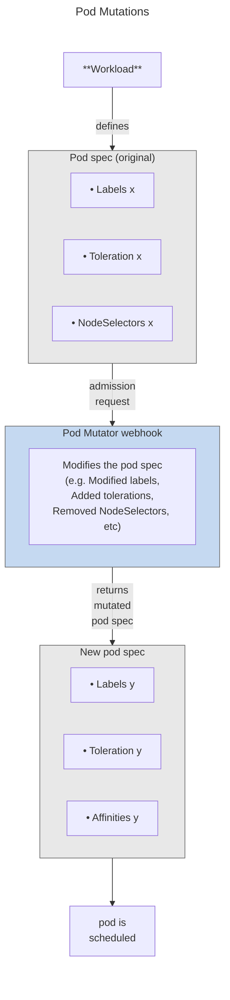

# Overview

Pod mutations is a Atlas feature that automatically modifies pod specifications when pods are created. By intercepting pod creation at the Kubernetes admission stage, pod mutations apply configuration changes—such as labels, tolerations, node selectors, and Spot Instance settings—without requiring changes to your deployment manifests.

Pod mutations are implemented as Kubernetes Custom Resources (`PodMutation`), making them fully compatible with GitOps workflows and declarative cluster management. The cluster serves as the single source of truth: mutations created in the Atlas console sync to your cluster as custom resources, and mutations applied directly to the cluster (via kubectl, Terraform, ArgoCD, etc.) sync back to Atlas.

# Why use pod mutations?

Managing Kubernetes workloads at scale presents several challenges that pod mutations address.

**Complex configuration requirements.** As clusters grow, manually configuring pod specifications becomes time-consuming and error-prone. Each workload may need specific labels, tolerations, and node selectors to ensure proper scheduling. Pod mutations let you define these configurations once and apply them automatically to matching pods.

**Legacy system integration.** When onboarding existing clusters to Atlas, workloads may need to be reconfigured to take advantage of cost optimization features, such as Spot Instances or Node Template consolidation. Traditionally, this requires updating deployment manifests across many repositories. Pod mutations automate this.

**Resource fragmentation.** Without standardized pod configurations, clusters can become fragmented with too many node groups, leading to inefficient resource utilization. Pod mutations can consolidate workloads onto fewer Node Templates, improving bin-packing and reducing costs.

**GitOps and infrastructure-as-code workflows.** Teams using declarative tools like ArgoCD or Terraform need mutations to be manageable as code. Because pod mutations are Kubernetes custom resources, they integrate naturally with your existing GitOps workflows, enabling version control, code review, and approval.

# Key concepts

## PodMutation custom resource

Each pod mutation is represented as a Kubernetes custom resource of kind `PodMutation`. This resource defines two things: which pods the mutation applies to (via filters), and what changes to make (via configuration options).

```yaml
apiVersion: pod-mutations.atlas.example/v1
kind: PodMutation
metadata:
  annotations:
    pod-mutations.atlas.example/pod-mutation-id: 6de5fd3f-500d-4b6c-b0b2-adf10f6a009b
    pod-mutations.atlas.example/pod-mutation-name: demo-label-mutation
    pod-mutations.atlas.example/pod-mutation-source: api
  creationTimestamp: "2025-12-17T15:06:05Z"
  generation: 1
  name: api-mutation-6de5fd3f-500d-4b6c-b0b2-adf10f6a009b
  resourceVersion: "74105"
  uid: fb84c26f-1bca-4d73-b243-3659b0f9a987
spec:
  filter:
    pod: {}
    workload: {}
  filterV2:
    pod:
      excludeLabels: {}
      labels: {}
    workload:
      namespaces:
      - type: exact
        value: pod-mutation-demo
  patchesV2:
  - operations:
    - op: add
      path: /metadata/labels/mutated-by
      value: atlas
  restartPolicy: deferred
  spotConfig: {}
```

This example creates a mutation that applies to pods in the `pod-mutation-demo` namespace and applies the label `mutated-by: atlas`to them.

## Two-way synchronization

Pod mutations support two-way sync between the Atlas console and your cluster:

* **Console to cluster:** Mutations you create or edit in the Atlas console are automatically synced to your cluster as `PodMutation` custom resources.
* **Cluster to console:** Mutations you apply directly to your cluster (using kubectl, Helm, Terraform, or other tools) are discovered by Atlas and appear in the console. These mutations display a "(Custom Resource in cluster)" suffix and cannot be edited through the UI—all changes must be made via your cluster management tools.

This architecture means the cluster is always the source of truth. The pod mutator component reads mutation definitions only from the cluster, not from Atlas APIs.

## Single mutation per pod

Only one mutation can apply to any given pod. When multiple mutations have filters that match the same pod, Atlas uses a specificity scoring system to select the most targeted mutation:

| Filter criterion        | Specificity score |
| ----------------------- | ----------------- |
| Workload name specified | 4 points          |
| Pod labels specified    | 2 points          |
| Namespace specified     | 1 point           |

The mutation with the highest total score wins. For example, a mutation targeting "deployment `frontend` with label `tier=web` in namespace `production`" (score: 7) takes precedence over a mutation targeting "all pods in namespace `production`" (score: 1).

If two mutations have the same score, Atlas applies tie-breaking rules in this order: fewer workload names wins, then fewer namespaces, then more label conditions, and finally alphabetical order by mutation name.

To avoid relying on this precedence system, design your mutations with mutually exclusive filters whenever possible.

## Filter options

Pod mutations provide flexible filtering to target specific workloads:

* **Namespace selector:** Match pods by namespace name, with support for regex patterns.
* **Workload selector:** Match by workload name and kind, with regex support. The pod mutator walks the ownership chain of a pod through known Kubernetes types (for example, Pod → ReplicaSet → Deployment → custom resource) and matches against any owner in that resolved chain. This means you can filter by a custom resource kind that owns a standard workload (such as `Loki` or `Tempo`) or by an intermediate owner kind (such as `Deployment`).
* **Pod label selector:** Match by pod labels using AND/OR logic to combine multiple conditions.
* **Tolerations selector:** Match by pod tolerations using AND/OR logic. Check for specific toleration keys, operators, and values.
* **CEL expression filter:** Use a CEL (Common Expression Language) expression evaluated against the full Kubernetes Pod object to match on any pod field — container images, probes, resource requests, annotations, environment variables, and more.

The AND/OR label and toleration filtering lets you create precise targeting rules. For example, you can target pods that have (`environment=production` AND `tier=frontend`) OR (`app=critical`), or pods that tolerate both `scheduling.atlas.example/spot` AND a specific node template.

CEL expressions provide even more advanced filtering. For example, you can target pods that have a container running the `nginx` image, pods that have a startup probe defined, or pods with a specific annotation value. See the [Pod mutations reference](pod-mutations-reference.md#cel-expression-filter) for CEL expression syntax and examples.

## Configuration options

Pod mutations can apply various configuration changes:

| Configuration                 | Description                                                                  |
| ----------------------------- | ---------------------------------------------------------------------------- |
| Node templates to consolidate | Merge multiple Node Templates so pods can schedule on nodes from any of them |
| Annotations                   | Add annotations to pods                                                      |
| Labels                        | Add labels to pods                                                           |
| Taints and tolerations        | Add tolerations so pods can schedule on tainted nodes                        |
| NodeSelector                  | Add or remove node selector entries                                          |
| Spot configuration            | Configure Spot Instances and distribution percentage                         |
| Custom JSON Patch             | Apply advanced modifications using RFC 6902 JSON Patch operations            |

Multiple configuration types can be combined in a single mutation. They are applied together when a matching pod is created.

# How it works

The pod mutator runs as a Kubernetes Mutating Admission Webhook in your cluster. When a pod is created, the following sequence occurs:

1. **Interception:** The Kubernetes API server sends the pod specification to the pod mutator webhook before the pod is scheduled.

2. **Matching:** The mutator evaluates all `PodMutation` custom resources in the cluster to find those with filters matching the new pod.

3. **Selection:** If multiple mutations match, the mutator selects the most specific one using the scoring system described above.

4. **Mutation:** The mutator applies the selected mutation's configuration changes to the pod specification.

5. **Admission:** The modified pod specification is returned to the API server, and the pod proceeds to scheduling with the new configuration.



Because mutations are applied at creation time, they only affect newly created pods. Existing pods are not modified. Changes to a mutation definition take effect the next time matching pods are created—for example, during a deployment rollout or when pods are rescheduled.

# Enforcement

By default, pod mutations only apply to newly created pods—existing pods remain unchanged until they are recreated. The **enforcement** feature closes this gap by automatically detecting pods that are out of compliance with the current mutation configuration and evicting them so they are recreated with the correct settings.

## How enforcement works

When enforcement is enabled, the pod mutator periodically scans running pods in the cluster and evicts pods that are out of compliance. The workload controller then recreates them, and the mutating webhook applies the correct mutation to the new pods.

> 📘 Note
>
> Enforcement currently supports **Deployments only**. Pods managed by other workload controllers (StatefulSets, DaemonSets, Jobs, etc.) are not evicted by the enforcer.

To prevent excessive disruption, the enforcer rate-limits evictions using the `maxEvictionsPerMinute` setting. Within each eviction batch, the enforcer prioritizes pods that are Pending or not ready before evicting healthy Running pods.

> ⚠️ Warning
>
> Enforcement evicts non-compliant pods automatically. Review your mutation filters carefully before enabling this feature in production to avoid unintended pod restarts.

## When does the enforcer evict a pod?

The enforcer evicts a pod when it detects one of the following conditions:

**Configuration mismatch** — the pod's current state does not match the mutation that should apply to it:

* **Wrong or missing mutation:** The pod was never mutated, or it was mutated by a different `PodMutation` than the one that currently has the highest specificity score for it.
* **Mutation updated:** The `PodMutation` spec changed since the pod was created—patches, spot configuration, or distribution groups were added, modified, or removed—and re-applying the current mutation would produce a different pod configuration.

**Distribution skew** — the actual pod distribution has drifted from the configured target:

* **Spot distribution skew:** The ratio of spot to on-demand pods does not match the `spotConfig.distributionPercentage`. The enforcer evicts excess spot pods or excess on-demand pods to rebalance toward the target.
* **Distribution group skew:** The number of pods in a distribution group does not match the group's configured `percentage`. The enforcer evicts excess pods from over-represented groups.

## Availability and prerequisites

Enforcement is available starting from pod-mutator Helm chart version **0.12.0** and is **disabled by default**.

Enforcement requires **leader election** to be enabled. Leader election ensures only one pod-mutator replica performs enforcement at a time, preventing duplicate evictions. Enabling the enforcer without leader election will cause the Helm installation to fail.

## Enabling enforcement

### During onboarding

When onboarding a new cluster with `atlasctl cluster connect`, you can enable enforcement from the start by providing a values file via the `--umbrella-values-file` flag.

Create a YAML file with the enforcement and leader election settings:

```yaml
# atlas-values.yaml
autoscaler:
  atlas-pod-mutator:
    enforcer:
      enabled: true
    leaderElection:
      enabled: true
```

Pass this file to `atlasctl cluster connect`:

```shell
atlasctl cluster connect \
  --api-token="atlas_v1_..." \
  --api-region="prod" \
  --cluster-optimization=true \
  --umbrella-values-file=./atlas-values.yaml
```

The values you provide are merged with the configuration that `atlasctl` generates automatically (API key, cluster ID, feature toggles, etc.). Only settings that `atlasctl` does not manage directly—such as the pod-mutator enforcer configuration—are taken from your file.

### If the cluster is already onboarded

The command to enable enforcement on an existing cluster depends on whether the cluster was installed with the Umbrella helm chart or as standalone components (legacy mode).

#### Determining how the cluster was onboarded

Run the following command to determine whether the cluster uses the Umbrella helm chart:

```shell
helm list -n atlas-agent
```

If the output shows a single release named `atlas` with chart `atlas-<version>`, the cluster was onboarded with the Umbrella helm chart. If you see individual releases like `atlas-agent`, `pod-mutator`, `atlas-evictor`, etc., the cluster was onboarded without the Umbrella chart.

#### Without the Umbrella helm chart

Run the following Helm command to enable enforcement on an existing pod-mutator installation:

```shell
helm upgrade --install pod-mutator atlas-helm/atlas-pod-mutator \
  --namespace atlas-agent --reset-then-reuse-values \
  --set enforcer.enabled=true \
  --set leaderElection.enabled=true
```

#### With the Umbrella helm chart

If the cluster was onboarded using the `atlas` Umbrella helm chart, use the following command instead:

<Tabs>
  <Tab title="Standard (EKS, AKS, GKE)">

```shell
helm upgrade atlas atlas-helm/atlas \
  --namespace atlas-agent \
  --reset-then-reuse-values \
  --set autoscaler.atlas-pod-mutator.enforcer.enabled=true \
  --set autoscaler.atlas-pod-mutator.leaderElection.enabled=true
```

  </Tab>
  <Tab title="Anywhere clusters">

On Anywhere clusters, component configuration is passed through the `autoscaler-anywhere` prefix instead of `autoscaler`:

```shell
helm upgrade atlas atlas-helm/atlas \
  --namespace atlas-agent \
  --reset-then-reuse-values \
  --set autoscaler-anywhere.atlas-pod-mutator.enforcer.enabled=true \
  --set autoscaler-anywhere.atlas-pod-mutator.leaderElection.enabled=true
```

  </Tab>
</Tabs>

> 📘 Note
>
> The `--reset-then-reuse-values` flag requires **Helm v3.14.0 or higher**.

#### Customizing enforcement behavior

You can fine-tune enforcement with these Helm values:

| Helm value                       | Description                                                         | Default |
| -------------------------------- | ------------------------------------------------------------------- | ------- |
| `enforcer.enabled`               | Enable enforcement                                                  | `false` |
| `enforcer.scanInterval`          | How often the enforcer scans for non-compliant pods                 | `10s`   |
| `enforcer.maxEvictionsPerMinute` | Global rate limit for pod evictions per minute across all workloads | `60`    |
| `leaderElection.enabled`         | Enable leader election (required when enforcement is enabled)       | `false` |

# Compatibility with other admission webhooks

Pod Mutator coexists safely with other Kubernetes mutating admission webhooks, including policy engines such as [Kyverno](https://kyverno.io). However, there are a few things to keep in mind when running multiple webhooks on the same cluster.

## Webhook invocation order

Kubernetes does not guarantee a deterministic order in which mutating admission webhooks are called. Do not design your mutation rules assuming that Pod Mutator always runs before or after another webhook. Both webhooks will eventually run, but the order can vary between pod creation events.

For guidance on this, see the [Kubernetes admission webhook best practices](https://kubernetes.io/docs/concepts/cluster-administration/admission-webhooks-good-practices/#dont-rely-webhook-order).

## Avoid mutating the same fields

If two webhooks both modify the same pod field, the last one to run wins — and the result is unpredictable given the non-deterministic ordering above. Design your mutation rules and any other webhook policies so they target different fields.

This is especially important for Spot Instance configuration. Atlas-managed spot-related labels, tolerations, and node affinities should be managed exclusively by Pod Mutator. Other webhooks should not touch these fields.

## Reinvocation policy

By default, Pod Mutator uses `reinvocationPolicy: Never`. This means that if another webhook modifies a pod *after* Pod Mutator has already run, Pod Mutator will not be reinvoked to observe those changes. Keep this in mind when running other webhooks alongside Pod Mutator.

## Using with Container Live Migration

Mutations whose scheduling outcome is decided per pod at creation time are not supported with [Container Live Migration](clm-overview.md). See [Requirements and limitations](clm-requirements-and-limitations.md#scheduling-constraints-set-by-admission-webhooks).

# Limitations

* **New pods only:** Mutations apply only when pods are created. Existing pods are not affected until they are recreated (for example, during a rollout or rescheduling). Enable [enforcement](#enforcement) to automatically evict non-compliant pods so that their workload controllers recreate them and the correct mutation is applied.
* **One mutation per pod:** When multiple mutations match a pod, only the most specific one is applied. Design filters to be mutually exclusive to avoid unexpected behavior.
* **Immutable fields:** Some Kubernetes pod fields cannot be modified after creation. JSON Patch mutations that attempt to set these fields will be rejected.
* **Distribution drift:** With rapid scaling (for example, 0 to 10 replicas instantly), the actual Spot/On-Demand distribution may not match the configured percentage immediately. However, the maximum skew should not exceed 1 pod from the target distribution during upscaling. Over time, the system self-corrects as pods are recreated. If [enforcement](#enforcement) is enabled, the enforcer can also detect distribution skew and evict excess pods to rebalance toward the configured percentage.

# Related resources

To get started with pod mutations, see the [Pod mutations quickstart](pod-mutations-quickstart.md).

For detailed information on all configuration options and the CRD specification, see the [Pod mutations reference](pod-mutations-reference.md).