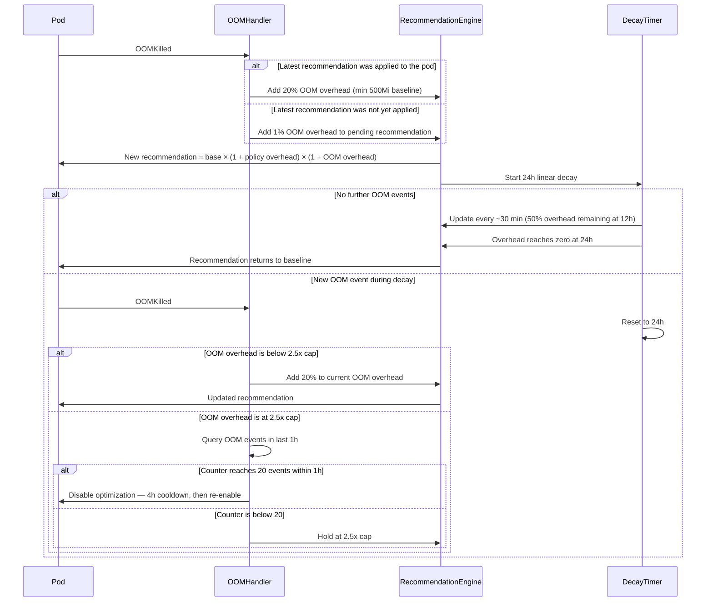

# Overview

Workload Autoscaler automatically scales your workload requests up or down to ensure optimal performance and cost-effectiveness.

# Getting started

To start using workload optimization, you must install the Workload Autoscaler component and the custom resource definitions for the recommendation objects. You can do this by getting the install script from our API or using our console once you visit the workload optimization page.

> 📘 Note
>
> Your cluster must be running in automated optimization mode, as workload optimization relies on the cluster controller to create the recommendation objects in the cluster.

<Image align="center" src="https://files.readme.io/12e839d-image2.png" />

## Supported Workload Types

The Atlas Workload Autoscaler supports optimization for the following native Kubernetes workload types:

| Workload Type | Support Added In | VPA Modes                | HPA Support          | Custom metrics |
| :------------ | :--------------- | :----------------------- | :------------------- | :------------- |
| Deployment    | Initial release  | Immediate and Deferred   | Supported            | Supported      |
| StatefulSet   | v0.13.0          | Immediate and Deferred   | Supported            | Supported      |
| DaemonSet     | v0.5.0           | Deferred only            | Not supported        | Not supported  |
| Rollout       | v0.6.0           | Immediate and Deferred\* | Supported            | Supported      |
| ReplicaSet    | v0.32.0          | Immediate and Deferred   | Supported (v0.44.4+) | Supported      |
| CronJob       | v0.44.3          | Immediate and Deferred   | Not supported        | Supported      |

\*For Rollouts, deferred mode is the default, but immediate mode can be enabled (v0.21.0+).

### DaemonSet support

DaemonSet workloads are supported from `workload-autoscaler` v0.5.0.

For DaemonSets — and any workload whose footprint scales with the node it runs on — you can also size requests as a percentage of node-allocatable CPU and memory. See [Node-aware DaemonSet sizing](woop-node-aware-daemonset-sizing.md).

## Agent Version Requirements

Different features require specific minimum versions of both the `workload-autoscaler` component and the Atlas agent. The Workload Autoscaler requires a minimum Kubernetes version of 1.18.

### High Availability Configuration

By default, since v0.30.0, the Atlas Workload Autoscaler runs in a high-availability configuration with two replica pods and includes anti-affinity to ensure the replica pods run on different nodes.

Only one instance performs operations like recommendation generation at any time, while the second instance remains ready to take over if needed.

### Atlas `workload-autoscaler` requirements

| Feature                                          | Minimum Version |
| :----------------------------------------------- | :-------------- |
| Deferred apply mode for recommendations          | v0.5.0          |
| High-availability with multi-replica             | v0.30.0         |
| Immediate apply mode for rollouts                | v0.21.0         |
| Resource-specific optimization                   | v0.23.1         |
| AKS Admissions Enforcer handling                 | v0.74.1         |
| Atlas horizontal workload scaling (deprecated) | v0.9.1          |
| Custom workloads                                 | v0.18.0         |
| Container grouping                               | v0.33.0         |
| Zero-downtime single-replica updates             | v0.35.3         |
| Immediate apply mode for custom workloads        | v0.41.2         |
| CronJob support                                  | v0.44.3         |
| Kubernetes HPA (Horizontal Pod Autoscaling)      | v0.44.4         |
| In-place pod resizing                            | v0.53.0         |
| Sidecar container optimization                   | v0.56.0         |
| 1-by-1 pod restart strategy                      | v0.57.0         |
| Whitelisting mode                                | v0.58.3         |
| Startup failure detection                        | v0.60.0         |
| Pod startup recommendations                      | v0.63.1         |
| ResourceQuota-aware scaling                      | v0.82.0         |
| Node-aware DaemonSet sizing                      | v0.105.0        |
| HPA target conversion                            | v1.0.11         |

### Atlas agent requirements

| Feature                                     | Minimum Version |
| ------------------------------------------- | --------------- |
| Kubernetes HPA (Horizontal Pod Autoscaling) | v0.60.0         |
| Argo Rollouts support                       | v0.62.2         |

### Atlas `cluster-controller` requirements

| Feature                     | Minimum Version |
| --------------------------- | --------------- |
| Workload Autoscaler support | v0.54.0         |

### Atlas `evictor` requirements

| Feature                        | Minimum Version    |
| ------------------------------ | ------------------ |
| Sidecar container optimization | helm chart 0.33.61 |

### Check your current version

To check your current agent version:

```shell Grep
kubectl describe pod atlas-agent -n atlas-agent | grep Image: | grep agent | head -n 1
```
```shell JsonPath
kubectl get pods -n atlas-agent -l app.kubernetes.io/name=atlas-agent -o jsonpath='{.items[0].spec.containers[?(@.name=="agent")].image}'
```

To check your current `workload-autoscaler` version:

```shell Grep
kubectl describe pod -n atlas-agent -l app.kubernetes.io/name=atlas-workload-autoscaler | grep Image:
```

To check your current `cluster-controller` version:

```shell Grep
kubectl describe pod -n atlas-agent -l app.kubernetes.io/name=atlas-cluster-controller | grep Image:
```

## Metrics collection and recommendation generation

Atlas needs to process metrics to generate recommendations, so you must install a [metrics-server](https://github.com/kubernetes-sigs/metrics-server). The Workload Autoscaler installation script installs it by default.

Workload Autoscaler **continuously monitors** workload metrics and compares them against current recommendations. When anomalous usage is detected (for example, metrics that are 50% higher than the recommended value), new recommendations are generated immediately without waiting for the regular cycle. Additionally, recommendations are regenerated every 30 minutes to handle gradual changes and ensure ongoing optimization.

**LimitRange Compliance**: When LimitRanges are present in a namespace, Workload Autoscaler automatically adjusts recommendations to comply with the defined constraints. Changes to LimitRanges trigger immediate recommendation updates to ensure workloads remain schedulable.

> 📘 Note
>
> All generated recommendations will consider the current requests/limits and any applicable LimitRange constraints.

**GKE Autopilot compliance**: On GKE Autopilot clusters, Workload Autoscaler automatically adjusts recommendations to comply with compute-class-specific resource constraints. See [GKE Autopilot support](#gke-autopilot-support).

**AKS Admissions Enforcer compliance**: On AKS clusters, Workload Autoscaler cannot apply recommendations to workloads in AKS protected namespaces until the Admissions Enforcer is disabled for the Workload Autoscaler webhook. See [AKS Admissions Enforcer support](#aks-admissions-enforcer-support).

## Applying recommendations automatically

Once the recommendation lands in the cluster, the Workload Autoscaler component is notified that a recommendation has been created or updated.

Next, Workload Autoscaler applies the recommendation according to the configured apply mode:

* **Immediate mode** (default): The autoscaler evicts pods using the Kubernetes Eviction API. The controller creates replacement pods, and the Atlas mutating admission webhook applies the updated resource requests at pod creation time. Pod Disruption Budgets are enforced by the Eviction API, so evictions are blocked when they would violate a budget.
* **Deferred mode**: The autoscaler never forces pod evictions. The Atlas mutating admission webhook applies the recommendation when pods are naturally recreated — for example, during application deployments, scaling events, or node maintenance. On Kubernetes v1.33+ clusters, recommendations may also be applied via in-place resizing without any pod restart.

Workload Autoscaler currently supports Deployments, StatefulSets, DaemonSets, ReplicaSets, CronJobs, and [Argo Rollouts](https://argoproj.github.io/rollouts/).

# How to enable Workload Autoscaler

## Scaling policies

Scaling policies allow you to manage all your workloads centrally, with the ability to apply the same settings to multiple workloads simultaneously. Moreover, you can create your custom policy with different settings and apply it to multiple workloads simultaneously.

When you start using our Workload Autoscaler component, all of your workloads will automatically have a default scaling policy applied to them at first, using our default settings. When a new workload appears in the cluster, it will automatically be assigned to the default policy.

If the default scaling policy is suitable for your workloads, you can enable scaling in two ways:

* **Globally** via the scaling policy by enabling **Automatically optimize workloads** – this will enable scaling only for the workloads we have enough data about. Workloads that aren’t ready will be checked later and enabled once the platform has enough data. When this setting is enabled on the default scaling policy, every new workload created in the cluster will be scaled automatically once the platform has enough data.
* **Directly** from the workload – once enabled, autoscaling will start immediately (depending on the autoscaler mode chosen at the policy level).

## How to configure recommendations

You can configure recommendations via the API to add additional overhead for a particular resource or change the function used to select the baseline for the recommendation.

For example, you can configure the MAX function to be used for CPU and set the overhead to 20%. This means that the CPU recommendation would be the maximum observed CPU usage over 24 hours plus 20% overhead.

You can find the optimization settings in the scaling policies. You can carry out the following configuration tasks:

* Scale recommendations by adding overhead.
* Fine-tune the percentile values for CPU and memory recommendations.
* Specify the optimization threshold.

<Image align="center" src="https://files.readme.io/96c4350-image3.png" />

You can fine-tune the following settings in the scaling policies:

* **Automatically optimize workloads** – the policy allows you to specify whether our recommendations should be automatically applied to all workloads associated with the scaling policy. This feature enables automation only when there is enough data available to make informed recommendations.
* **Recommendation percentile** – this determines which percentile Atlas will recommend considering the last day of usage. The recommendation will be the average target percentile across all pods spanning the recommendation period. Setting the percentile to 100% will no longer use the average of all pods but the maximum observed value over the period.
* **Overhead** – it marks how much extra resource should be added on top of the recommendation. By default, it's set to 10% for memory and 10% for CPU.
* **Autoscaler mode** - this can be set to **immediate** or **deferred**.
* **Optimization threshold** – when automation is enabled and Workload Autoscaler works in immediate mode, this value determines when to apply scaling recommendations.
  For upscaling, the threshold is calculated relative to current resource requests, while for downscaling, it's calculated relative to the new recommended value.
  For example, with a threshold of 10%, an upscale from 100m to 120m CPU would be applied immediately (20% increase relative to current 100m), while an upscale from 110m to 120m would not be applied immediately (8% increase relative to new 110m).
  The default value for both memory and CPU is 10%.

### Immediate vs. deferred scaling mode

If the autoscaler mode is set to **immediate**, it will check if a new recommendation meets the user-set optimization thresholds. It won't be applied if the recommendation doesn’t meet these thresholds. If it does pass the threshold, Workload Autoscaler will automatically modify pod requests per the recommendation.

Moreover, Workload Autoscaler will also apply new recommendations upon natural pod restarts, such as a new service release or when a pod dies due to a business or technical error. This helps to avoid unnecessary pod restarts.

If the scaling mode is set to **deferred**, Workload Autoscaler will not initiate a forced restart of the pod. On Kubernetes v1.33+ clusters, it may apply the recommendation via in-place resizing without any restart. Otherwise, it applies the recommendation whenever external factors initiate pod restarts.

#### System overrides for scaling mode

> 🚧 Notice
>
> In certain scenarios, Workload Autoscaler may **override** the chosen scaling mode to ensure optimal performance and prevent potential issues.

Here are some cases where the system may default to deferred mode, even if immediate mode is selected:

1. **Hard node requirements**: Workloads with certain specific node constraints are set to deferred mode. This includes:
   * **Specific pod anti-affinity**: If a workload has pod anti-affinity rules that use the `kubernetes.io/hostname` as the `topologyKey` within a `requiredDuringSchedulingIgnoredDuringExecution` block.
   * **Host network usage**: Pods that require the use of the host's network.

These constraints are considered hard node requirements. Using deferred mode in these cases prevents potential scheduling conflicts and resource issues that could arise from immediate pod restarts.

2. **Rollouts**: Workloads of the Rollout kind are always set to deferred mode, as they have their own update mechanisms that could conflict with immediate scaling.

These overrides help maintain cluster stability and prevent scenarios where immediate scaling could lead to increased costs or resource conflicts. Check your workload configurations for these conditions if you notice unexpected deferred scaling behavior.

### Mark of recommendation confidence

Atlas's Workload Autoscaler uses recommendation confidence to determine how aggressively to optimize your workloads. Confidence is based on the quality and quantity of historical usage data available for analysis.

#### Confidence levels

**Full confidence** workloads have sufficient historical data for Workload Autoscaler to generate reliable, unrestricted recommendations. These workloads receive optimization based on comprehensive usage analysis without artificial limits. See [building sufficient confidence](#building-sufficient-full-confidence) to learn what is required for a workload to be considered as having full confidence.

**Low confidence** workloads lack sufficient historical data for reliable analysis. The autoscaler applies different optimization strategies depending on how optimization for the workload was enabled:

* **Policy-optimized workloads**: Receive gradual scaling with conservative limits during the confidence-building period
* **Manually enabled workloads**: Receive unrestricted recommendations immediately, bypassing confidence checks

#### Gradual scaling for new clusters

For newly onboarded clusters (within the first 24 hours), Workload Autoscaler provides immediate optimization benefits through gradual scaling, even for workloads with low confidence. This allows you to see optimization results within hours rather than waiting days for complete data collection.

| Workload Data | Max Resource Request Adjustment | Behavior After Threshold      |
| ------------- | ------------------------------- | ----------------------------- |
| < 2.4 hours   | 10%                             | -                             |
| < 6 hours     | 25%                             | -                             |
| < 24 hours    | 35%                             | -                             |
| > 24 hours    | -                               | Confidence-based optimization |

During this period:

* **Policy-optimized workloads** automatically receive conservative resource adjustments with progressive limits
* **Manually enabled workloads** (via annotations or direct UI toggle) bypass gradual scaling and receive unrestricted recommendations immediately

#### Confidence indicators in the UI

The **Recommendation Confidence** column displays visual indicators for workloads with low confidence:


Workloads showing low confidence indicators and belonging to automated scaling policies will be scaled gradually for the first 24 hours, then wait for sufficient (full) confidence before transitioning to unrestricted optimization.

#### Building sufficient (full) confidence

For Workload Autoscaler to consider confidence as sufficient for unrestricted optimization:

1. **Minimum monitoring period**: The workload must be monitored for at least 24 hours, even for existing workloads in newly connected clusters.

2. **Adequate metric density**: Beyond the minimum 24-hour requirement, workloads with longer [look-back periods](workload-autoscaling-configuration.md#look-back-period) need metrics for approximately 40% of the configured period. For example, with a 7-day lookback period, confidence continues building over about 3 days of continuous operation.

## How to create a new scaling policy?

Scaling policies are a great tool for managing multiple workloads at once. Some workloads may require a higher overhead, while others would be unnecessary.

The recommended way to get tailored policies fast, especially for a newly connected cluster, is to let [AtlasPilot Assistant](woop-scaling-policies-atlaspilot-assistant.md) analyze your cluster and generate a complete set of policies and assignment rules for you based on your intent. You review what AtlasPilot Assistant proposes, then apply with one click.

To create and manage scaling policies manually, refer to our dedicated guides:

* [How-to: Create a scaling policy](woop-scaling-policies-create.md)
* [How-to: Manage scaling policies](woop-scaling-policies-manage.md)

### Enabling Workload Autoscaler for a single workload

To enable optimization for a single workload:

* Select the workload you want to optimize.
* The drawer that opens allows you to review the historical resource usage and recommendations, view current settings, and toggle optimization on or off.
* Once you’ve made the review, click the Turn Optimization On button and save the changes.

# OOM event handling

Despite careful monitoring and historical data analysis, out-of-memory (OOM) events can occur due to sudden workload spikes or application-level issues.

Atlas Workload Autoscaler has a robust system for handling possible OOM events in Kubernetes clusters. This feature prevents OOMs by dynamically adjusting memory allocations based on historical data and recent events.

## Detection

The system detects OOM events by monitoring pod container statuses.

1. The Atlas Agent collects pod data through regular snapshots.
2. Pod container termination states are extracted from these snapshots:
   ```json
   {
     "name": "data-analysis-service",
     "lastState": {
       "terminated": {
         "exitCode": 137,
         "reason": "OOMKilled",
         "startedAt": "2023-08-16T13:51:08Z",
         "finishedAt": "2023-08-16T13:58:43Z",
         "containerID": "containerd://8f7e9bc23a1d5f6g987h654i321j987k654l321m987n654o321p987q654r"
       }
     }
   }
   ```
3. When an `OOMKilled` state is detected, an OOM event is emitted.
4. The OOM event is stored in the database to ensure each event is handled only once.

When a container is terminated with the reason `OOMKilled`, it triggers the OOM handling process.

## OOM kills on workloads without metrics

OOM kill handling also covers workloads that have no recommendation or collected metrics yet — for example, a brand-new workload that OOMs shortly after deployment, or a workload that runs too infrequently to accumulate usage metrics, such as a CronJob. Previously, OOM kills on such workloads were detected but not handled, because generating a recommendation requires metrics history.

For these workloads, Workload Autoscaler builds an initial recommendation from the workload's spec requests:

1. When an OOM kill is detected on a workload with no existing recommendation, the system triggers a forced recommendation generation for it.
2. With no metrics to draw from, the generated recommendation uses the container resource requests defined in the workload spec as the baseline.
3. The OOM memory overhead is applied on top of that baseline, exactly as for established workloads (see [Memory overhead adjustment](#memory-overhead-adjustment)).
4. Once this initial recommendation exists, the workload is handled like any other workload that experiences OOM kills.

This initial recommendation requires the following:

* Vertical autoscaling must be enabled for the workload.
* The OOM-killed container must define both CPU and memory requests in the workload spec. Only container-level requests are used — pod-level resource requests are not. If either request is missing, the OOM kill is detected but no recommendation is generated, and handling begins once the workload has accumulated [enough metrics](#mark-of-recommendation-confidence).

> 📘 OOM reaction is unchanged
>
> The reaction to OOM kills is the same as for any other workload: memory increases incrementally up to the 250% cap, and optimization is automatically disabled if the workload keeps OOMing (see [Automatic optimization disable](#automatic-optimization-disable)).

## Handling

When an OOM event is detected, the system takes the following actions:

1. The OOM event handler watches for new OOM events.
2. Upon receiving an event, it adjusts the configuration based on the previous workload state.
3. A new recommendation is generated with increased memory overhead.

### Memory overhead adjustment



The system uses an incremental approach to adjust memory overhead:

1. **Initial OOM event:** requested memory is increased either by 20% or 100Mi, whichever is the greater of the two values.
2. **If the latest recommendation was not yet applied** to the OOM-killed pod container when the OOM occurred, the overhead increase is only 1% (x1.01) on top of the pending recommendation rather than 20%. The system tracks whether recommendations have been applied before counting new OOM events toward the rolling 1-hour threshold.
3. **If no further OOM events occur**, the OOM overhead decreases linearly back to zero over 24 hours, with recommendations updated approximately every 30 minutes. At the 12-hour mark, the overhead is 50% of its post-OOM value. Each new OOM event resets this 24-hour timer. When enforcement is set to **defer**, the reduced memory takes effect on the next pod restart — no restart is forced.
4. **If another OOM event occurs** while overhead is still elevated:
   * The system starts from the current overhead value.
   * An additional 20% (or 100Mi, whichever is greater) is added to the current value.

> 📘 OOM overhead vs. scaling policy overhead
>
> The OOM overhead described here is separate from the memory overhead configured in your vertical scaling policy. Both are applied when generating a recommendation:
> `final recommendation = base recommendation × (1 + policy overhead) × (1 + OOM overhead)`

**For example:**

* A workload with a 100Mi recommendation that experiences an OOM event: 20% of 100Mi = 20Mi, but the minimum increase is 100Mi, so the recommendation rises to 200Mi.
* A workload with a 500Mi recommendation: 20% of 500Mi = 100Mi, which equals the minimum, so the recommendation rises to 600Mi after an OOM event.
* If a pending OOM recommendation of 1 GiB has not yet been applied and another OOM event occurs, the pending recommendation increases to 1.01 GiB rather than 1.2 GiB.
* If the current OOM overhead is 5% (x1.05) when an OOM occurs again, it increases to 25% (x1.25).
* This process can continue up to a maximum of 2.5x the original allocation.
* The maximum memory overhead is capped at 2.5x (250%) the original allocation. If a workload reaches this ceiling and continues to experience OOM kills, it will eventually trigger the automatic optimization disable after 20 events within a rolling 1-hour window and enter a 4-hour cooldown period.

## Recommendation regeneration

After adjusting the configuration, the OOM handler invokes the recommendation generator with the latest settings. This process does the following:

1. Generates a new recommendation based on the adjusted configuration.
2. Emits a `recommendation generated` event.
3. Applies the new recommendation asynchronously.

## Automatic optimization disable

As a safety mechanism,  Workload Autoscaler automatically disables optimization for workloads experiencing persistent OOM events that cannot be resolved through memory adjustments.

### How it works

If a workload experiences **20 OOM kill events within a rolling 1-hour window**, the system automatically disables optimization for that specific workload. This prevents the autoscaler from continually adjusting a workload that may have underlying issues unrelated to resource sizing.

The OOM counter operates as follows:

1. Each OOM kill event increments the counter within the rolling 1-hour window.
2. The counter does **not** reset when a new recommendation is generated.
3. The counter resets only after a recommendation has been **applied** and the system identifies a subsequent OOM kill event.
4. OOM kill events are only recognized within a **10-minute detection window** — if a recommendation has not been applied, only OOM kills older than 10 minutes from the last OOM event are counted. This means at most 6 OOM kills can be recognized per hour under normal detection conditions.

This ensures the system waits for recommendations to take effect before reevaluating their impact.

## Continuous OOM kill detection

Continuous OOM kill detection observes raw `OOMKilled` terminations directly, independent of recommendation handling. It catches workloads that OOM-kill continuously for hours, even when their recognized event count never reaches the [automatic optimization disable](#automatic-optimization-disable) threshold.

### How continuous OOM detection works

1. Workload Autoscaler checks the workload's pods at every snapshot processing cycle. It records an OOM observation when a pod container shows an `OOMKilled` termination that is less than 5 minutes old. This observation does not depend on whether the OOM kill triggered a recommendation update.
2. OOM observations less than 20 minutes apart extend the same continuous streak. The streak resets if 20 minutes pass without an OOM observation.
3. A streak reaches 2 hours when no gap of 20 minutes or more separates its OOM observations. Workload Autoscaler then disables optimization for the workload:
   * The workload switches to read-only mode: recommendations are still generated but no longer applied.
   * The workload is marked with an error in the console, prompting you to check the application health.
   * Workload Autoscaler sends a warning notification to your configured notification channels.
   * Workload Autoscaler records a system override event in the [Event log](event-log.md).

> 📘 Note
>
> Continuous OOM kill detection applies to workloads that have vertical autoscaling enabled and an existing recommendation.
> If a workload has no recommendation yet, the first OOM kill triggers an initial one as described in [OOM kills on workloads without metrics](#oom-kills-on-workloads-without-metrics).
> For workloads with JVM optimization enabled, containers that exit due to JVM heap out-of-memory errors also count as OOM observations.
> After optimization is re-enabled, the workload must OOM-kill for another uninterrupted 2 hours before Workload Autoscaler disables optimization again.

## Automatic re-enable

After 4 hours, the system automatically re-enables optimization for the workload. The same re-enable behavior applies whether optimization was disabled by the event-count threshold or by [continuous OOM kill detection](#continuous-oom-kill-detection). This allows the autoscaler to attempt optimization again after a cooldown period, which can help in cases where:

* The underlying application issue has been resolved
* Traffic patterns have changed
* The workload's memory requirements have stabilized

If the workload continues to experience OOM kills after re-enablement, the disable cycle repeats.

# Handling memory pressure events

Workload Autoscaler has built-in logic to handle memory pressure events and prevent pod evictions due to out-of-memory (OOM) issues. This feature is particularly important in tightly packed clusters where increased pod memory usage might trigger eviction events before the OOM kill, and pods might enter eviction loops due to unaddressed memory pressure.

## Understanding memory pressure evictions vs OOM kills

It's important to distinguish between memory pressure evictions and OOM kills:

* **Memory pressure evictions**: These occur when a node is under memory pressure but before the pod reaches its memory limit. Evictions happen in the range between a pod's memory request and its limit. The Kubernetes scheduler may evict pods to free up resources and maintain node stability.
* **OOM kills**: These happen when a pod exceeds its memory limit. The container runtime terminates the pod immediately.

## How it works

When a memory pressure eviction event is detected, the autoscaler follows this process:

1. Check if the pod experiencing the eviction is managed by Atlas.
2. Determine if this pod is the one causing the memory pressure.
3. Verify if the pod's memory usage data is available in the event.
4. If all conditions are met, create a system override for minimum memory adjustment.

> 📘 Minimum memory adjustment calculation
>
> * Pod's memory usage at the time of the eviction event
> * Plus the configured memory overhead (as defined in the vertical scaling policy)

This adjustment is applied when generating the next recommendation for the pod and remains in effect for 8 hours to ensure stability.

### Criteria for adjustment

It's important to note that this mechanism only applies to pods that meet the following criteria:

| Criterion             | Requirement                                               |
| --------------------- | --------------------------------------------------------- |
| **Management**        | Atlas must manage the pod                               |
| **Cause**             | The pod must be directly causing memory pressure          |
| **Data Availability** | Memory usage data must be available in the eviction event |

> 🚧 Notice
>
> No automatic adjustment is made for pods that don't meet all these criteria.

This targeted approach ensures that the autoscaler efficiently addresses the root cause of memory pressure events.

# Surge handling

Workload Autoscaler includes a surge detection and handling mechanism that automatically responds to rapid increases in resource utilization. This feature ensures your workloads remain stable during traffic spikes or unexpected load increases without requiring manual intervention.

## How surge detection works

The system continuously monitors container resource usage and compares it with current Vertical Pod Autoscaler (VPA) recommendations. A surge is detected when usage exceeds certain thresholds:

* **CPU surge**: Detected when there's both a minimum absolute increase of `100m` CPU and a minimum relative increase of `100%` (comparing average usage to VPA recommendation)
* **Memory surge**: Detected when there's both a minimum absolute increase of `100Mi` and a minimum relative increase of `20%` (comparing average usage to VPA recommendation)

If the surge continues, the system will re-evaluate every 15 minutes to track ongoing elevated resource usage.

## Automatic response to surges

When a surge is detected, Workload Autoscaler dynamically adjusts the configuration of the affected workload and generates new VPA recommendations:

1. **Progressive lookback shortening**: For every 15 minutes since the surge started, the system shortens the lookback period to focus on recent usage patterns
2. **Gradual quantile increase**: For every 5 minutes since the surge started, the system increases the quantile used for recommendations to be more conservative

These adjustments help the system respond more quickly to rising resource demands while maintaining stability.

## Workloads with Horizontal Pod Autoscaler

For workloads with a native Kubernetes HPA, surge detection behaves differently. Workload Autoscaler suppresses surge detection as long as the HPA has not scaled to its maximum replica count.

HPA responds to load increases by adding replicas horizontally, which is faster than adjusting vertical resource recommendations and waiting for pods to restart. Workload Autoscaler defers to HPA as the first line of defense against traffic spikes. Surge detection activates only when horizontal scaling capacity is fully exhausted. That is, when the workload is already running at `maxReplicas`.

### Why spikes may not affect recommendations

Even when you sometimes see a spike in the console for such a workload, it may not necessarily change the CPU/memory recommendation due to per-pod aggregation.

**Per-pod aggregation**: Recommendations are calculated per container across all pods. If only a small number of pods experience a spike out of many replicas, the spike has minimal statistical weight. For example, if 5 out of 100 pods briefly exceed the recommendation, a P95 quantile calculation over a multi-day lookback window treats those data points as outliers.

## Temporary configuration adjustments

The surge-related configuration adjustments are temporary and expire based on the original quantile configured:

* Adjustments for workloads using lower quantiles (e.g., `p50`) last up to 12 hours
* Adjustments for workloads using higher quantiles (e.g., `p99`) last as little as 1 hour
* The maximum duration for any surge configuration adjustment is 24 hours

After the adjustment period expires, the system reverts to using the original configuration for VPA recommendations.

> 📘 Note
>
> These adjustments only apply to workloads using the `quantile` function for recommendation generation. Workloads configured to use the `max` function already use the maximum observed value, so no configuration adjustment is needed during surges.

## Recommendation generation and application

After adjusting the configuration, the surge handler follows this process:

1. Generates a new recommendation based on the adjusted configuration
2. Records a `recommendation generated` event in the system
3. Applies the new recommendation according to the workload's configured scaling mode

You can view surge detection events and the resulting adjustments in the [Event log](event-log.md), which provides visibility into how Workload Autoscaler responds to changing resource demands.

# Startup failure detection

Optimized resource requests can leave workloads without enough CPU or memory to pass their readiness and startup probes during initialization. This is especially common when workloads rely on a configured [startup period](woop-configuration-settings.md#startup-metrics) that excludes initialization metrics from recommendations, or when many workloads restart simultaneously after enabling optimization.

## How it works

Workload Autoscaler collects the `prober_probe_total` metric from each node via the `atlas-workload-autoscaler-exporter`. A startup failure event is raised when the number of **readiness** or **startup** probe failures for a workload exceeds **10 in the last 5 minutes**.

> 📘 Note
>
> Probe failure metrics reflect individual check failures, not definitive pod failures. A probe can fail multiple times before the `failureThreshold` is reached. If the probe eventually succeeds, the earlier failures are still counted.

When a startup failure is detected, Workload Autoscaler adds **20% overhead** to both CPU and memory recommendations. This overhead decays over time, similar to [OOM kill memory overhead](#memory-overhead-adjustment). Unlike OOM handling, repeated detections reset the overhead to 20% rather than stacking additional increases.

Startup failure detection requires VPA optimization to be enabled, at least one recommendation to have been generated, and `atlas-workload-autoscaler-exporter` v0.60.0 or later. The exporter is installed by default during cluster onboarding — see [Custom metrics](woop-custom-metrics.md) for manual installation instructions.

> 📘 Relationship to pod startup recommendations
>
> [Pod startup recommendations](woop-startup-recommendations.md) proactively prevent startup issues by preserving original CPU requests during initialization. Startup failure detection is a reactive safety net for cases where the workload still fails to pass its probes. Both can be active on the same workload.

# GKE Autopilot support

Workload Autoscaler automatically detects GKE Autopilot clusters connected via [Atlas Anywhere](atlas-anywhere-overview.md) and adjusts resource recommendations to comply with Autopilot resource constraints. No configuration is required.

## How detection works

GKE Autopilot clusters connect to Atlas through Atlas Anywhere. Workload Autoscaler detects the Autopilot environment automatically through node labels (`cloud.google.com/machine-family`, `cloud.google.com/compute-class`). Pod bursting support is detected through the presence of the `efficiency-daemon` DaemonSet in the `kube-system` namespace. Detection runs on each snapshot processing cycle, approximately every 20 minutes.

## Resource constraints by compute class

GKE Autopilot enforces minimum and maximum resource values and CPU:memory ratios per compute class (general-purpose, balanced, scale-out, performance, and accelerator). Workload Autoscaler automatically clamps recommendations to stay within these limits. When pod bursting is enabled on the cluster, the general-purpose compute class uses lower minimums.

For the full list of constraints per compute class, see the <Anchor label="GKE Autopilot resource requests documentation" target="_blank" href="https://cloud.google.com/kubernetes-engine/docs/concepts/autopilot-resource-requests">GKE Autopilot resource requests documentation</Anchor>.

### How the compute class is determined

The compute class for each workload is determined in the following order:

1. `cloud.google.com/compute-class` annotation on the workload spec
2. `cloud.google.com/compute-class` node selector
3. GPU or TPU accelerator node selectors (`cloud.google.com/gke-accelerator` or `cloud.google.com/gke-tpu-accelerator`)
4. If none of the above apply, defaults to general-purpose

### Effect on recommendations

Because Autopilot minimum values are higher than the Workload Autoscaler defaults (for example, 250m CPU on Autopilot versus 10m on standard clusters), recommendations on Autopilot clusters will generally be higher. Scaling granularity is unaffected. A recommendation can still move from 250m to 260m; only the floor changes.

When CPU:memory ratio constraints apply, Workload Autoscaler adjusts the paired resource to keep recommendations within the allowed ratio.

## Protected namespaces

Workloads in the `kube-system` and `gke-gmp-system` namespaces are automatically assigned to a read-only scaling policy. GKE Autopilot manages workloads in these namespaces, so Workload Autoscaler does not apply recommendations to them.

# AKS Admissions Enforcer support

AKS Admissions Enforcer support requires the `workload-autoscaler` component version v0.74.1 or later.

On AKS, the Admissions Enforcer blocks custom admission webhooks from running in protected namespaces. While the enforcer is enabled, Workload Autoscaler cannot apply recommendations to workloads in those namespaces.

For more details, see the <Anchor label="AKS Admissions Enforcer documentation" target="_blank" href="https://learn.microsoft.com/en-us/azure/aks/faq#can-admission-controller-webhooks-affect-kube-system-and-internal-aks-namespaces-">AKS Admissions Enforcer documentation</Anchor>.

## AKS managed workloads

A workload is AKS-managed when it carries the `"kubernetes.azure.com/managedby": "aks"` label. Workload Autoscaler assigns these workloads to the built-in `readonly` scaling policy and does not apply recommendations to them, because AKS manages them. This cannot be changed by disabling the AKS Admissions Enforcer or by reassigning the workload to another policy.

## AKS protected namespaces

AKS treats the following namespaces as protected:

1. `kube-system`
2. Namespaces with the labels `"kubernetes.azure.com/managedby": "aks"` and `"control-plane": "true"` (AKS internal namespaces)

## Disabling the enforcer

To disable the enforcer for protected namespaces, set the `admissions.enforcer/disabled` annotation on the admission webhook:

```yaml
metadata:
  annotations:
    admissions.enforcer/disabled: "true"
```

Workload Autoscaler sets this annotation on its own webhook. To change this behavior, set `webhook.aksAdmissionsEnforcerDisabled` in your chart values:

```yaml
webhook:
  aksAdmissionsEnforcerDisabled: "auto"
```

| Value              | Behavior                                                                                                    |
| ------------------ | ----------------------------------------------------------------------------------------------------------- |
| `"auto"` (default) | Adds the annotation when the provider is AKS or cannot be resolved. Non-AKS clusters ignore the annotation. |
| `"true"`           | Always adds the annotation.                                                                                 |
| `"false"`          | Never adds the annotation.                                                                                  |

## How detection works

While the enforcer is enabled, Workload Autoscaler assigns workloads in protected namespaces to a read-only scaling policy and does not apply recommendations to them. If such a workload already has an applied recommendation, Workload Autoscaler deletes it.

Once the enforcer is disabled, Workload Autoscaler returns those workloads to their default scaling policy and generates recommendations for them accordingly.

### Effect on recommendations

When the enforcer is disabled, every workload in a protected namespace moves from the read-only policy to its default scaling policy at the same time. Expect a sudden increase in new recommendations at that point.

# Stall detection

Resource contention can cause workloads to underperform even when CPU usage appears normal. This happens when requests are set too low or the node lacks effective headroom. Workload Autoscaler uses Pressure Stall Information (PSI) metrics to detect hidden CPU contention and respond by adjusting resources.

## How stall detection works

The system collects CPU stall metrics per workload container, checking every 5 minutes for the percentage of time spent waiting for CPU. If the calculated percentage exceeds the configured threshold and enough pods are affected (based on the pod threshold), the Workload Autoscaler generates a new recommendation with adjustments designed to relieve contention. The recommendation is applied according to the scaling mode configured in the policy (immediate or deferred).

## Why stall detection improves performance

Traditional approaches to CPU contention, such as evicting and moving pods, often fail because:

* **Musical chairs effect**: Under-provisioned pods relocate the problem rather than solve it. Unless eviction is paired with an immediate change to requests and limits, you're spreading the same pain to another node.
* **Context blindness**: Eviction logic needs to understand what it's affecting and why. Without workload-aware context (SLO sensitivity, stall tolerance, intent), eviction can cause more harm than good.

By increasing CPU requests first, stall detection gives workloads higher cgroup weight, allowing them to burst more effectively and reducing contention. In some cases, this improves performance without a restart because the workload simply gets higher priority on the same node (using in-place resize). If the new requests no longer fit the node, Kubernetes can reschedule the pod, and the cluster can add capacity, avoiding the "move the pain elsewhere" pattern.

## Automatic response to stall

When CPU stall is detected and sustained, Workload Autoscaler progressively adjusts recommendations based on detection duration:

1. **Increased recommendation percentile**: Higher percentiles capture more of the workload's resource demand
2. **Shortened look-back window**: Focuses on recent usage patterns
3. **Increased overhead**: Surfaces demand that traditional metrics miss

After issuing a stall-aware recommendation, the system waits 15 minutes before re-evaluating that workload. This stabilization window gives the updated recommendation time to take effect. If stall persists after the stabilization period, the system can issue further adjustments.

The magnitude of each adjustment depends on multiple factors, including workload size, stall duration, the configured look-back period, and recommendation percentile. Immediate results also vary based on how the workload responds to increased requests—whether the additional resources successfully reduce CPU stall.

## Monitoring stall detection

You can monitor stall detection activity in several ways:

* **Event log**: The [Event log](event-log.md) records "CPU stall detected" events when thresholds are breached, showing stall percentage per container and the resulting recommendation adjustment.
* **Workload charts**: The workload detail page displays observed CPU stall in the resource charts, allowing you to track contention over time.


For information on configuring stall detection thresholds, see [Stall detection settings](woop-configuration-settings.md#stall-detection).

# Troubleshooting

<Callout icon="📘" theme="info">
  ### Which upgrade method to use

  The Helm commands on this page use the **umbrella chart** (`atlas-helm/atlas`) by default. If you need to use a different method:

  - **[atlasctl](connect-with-atlasctl.md)**: To upgrade all Atlas components at once without managing Helm flags:
    ```shell
    atlasctl atlasware upgrade
    ```
    This preserves your existing configuration. See the [atlasctl documentation](connect-with-atlasctl.md) for installation and authentication instructions.
  - **Individual charts**: If you installed each component as a separate Helm release (e.g., for ArgoCD or custom GitOps), replace the release name and chart reference with the component-specific ones (e.g., `atlas-workload-autoscaler` and `atlas-helm/atlas-workload-autoscaler`) and remove the `autoscaler.atlas-workload-autoscaler.` value prefix.

  Not sure which method you used? Run `helm list -n atlas-agent`. A single release named `atlas` means umbrella chart; separate releases like `atlas-workload-autoscaler` mean individual charts.
</Callout>

<br />

> 📘 Note
>
> Some of the Helm commands below use the `--reset-then-reuse-values` flag, which requires Helm v3.14.0 or higher.

## Failed Helm test hooks

When installing Workload Autoscaler, a [Helm test hook](https://helm.sh/docs/topics/chart_tests/) is executed to verify proper functionality. Workload autoscaler is an in-cluster component that applies resource request recommendations to workloads. For that, it uses two main mechanisms, the functionality of which is verified by the test hook.

The test validates these two key mechanisms:

* Reconciliation loop on Recommendation objects
* Admission webhook for Kubernetes Pod objects

A failed test indicates one or both mechanisms aren't working correctly, which prevents workload optimization. Follow these steps to identify and resolve the issue:

### Verify Recommendation CRD installation

1. Check the CRD status:

```shell
kubectl describe crd recommendations.autoscaling.atlas.example
```

The output should describe the object without any failure status.

2. Verify API server metrics:

```shell
kubectl get --raw /metrics | grep apiserver_request_total | grep recommendations
```

The output should show metrics for Recommendation objects being queried from the Kubernetes API server.

3. Review Workload Autoscaler logs for reconciliation messages containing `reconciling recommendation`. This shows that the reconciliation loop is being invoked.

### Check admission webhook invocation

1. Verify webhook metrics:

```shell
kubectl get --raw /metrics | grep apiserver_admission_webhook | grep workload-autoscaler.atlas.example
```

The output should show metrics from the Kubernetes API server invoking the admission webhook.

2. Check Workload Autoscaler logs for pod mutation messages containing `mutating pod resources`. This shows that the admission webhook is being invoked, and the Kubernetes pod is being mutated.

### Validate port configuration

Check that ports are aligned across components, i.e., the admission webhook is pointing to the port exposed by the service, and the service is pointing to the port exposed by Workload Autoscaler:

1. Check admission webhook port:

```shell
kubectl describe mutatingwebhookconfigurations atlas-workload-autoscaler
```

2. Check service port:

```shell
kubectl describe service atlas-workload-autoscaler
```

3. Check deployment port:

```shell
kubectl describe deployment atlas-workload-autoscaler
```

Look for the `WEBHOOK_PORT` environment variable value.

### AWS EKS with custom CNI (Calico, Cilium)

When using Amazon EKS with a custom CNI such as Calico or Cilium instead of the default AWS VPC CNI, additional configuration is required for Workload Autoscaler to function properly. The custom CNI setup can interfere with the admission webhook connectivity.

#### Configuration

For EKS clusters using custom CNI solutions like Calico or Cilium, you must enable host networking for Workload Autoscaler deployment. This ensures that the Kubernetes API server can properly invoke the admission webhook.

To configure Workload Autoscaler with host networking enabled:

> 📘 Configuration-only changes
>
> This command upgrades all components in the umbrella chart, not just Workload Autoscaler. To change configuration without upgrading component versions, pin the chart to your current version by adding `--version <your-current-chart-version>` to the command. Run `helm list -n atlas-agent` to check your current version.

```shell
helm upgrade atlas atlas-helm/atlas \
  -n atlas-agent \
  --reset-then-reuse-values \
  --set autoscaler.atlas-workload-autoscaler.hostNetwork=true
```

#### Host network and port conflicts

When running Workload Autoscaler with `hostNetwork=true`, the webhook service port is exposed directly on the node's network interface. This can lead to port conflicts if another service on the same node is already using the webhook port.

> 📘 Note
>
> Workload Autoscaler includes built-in pod anti-affinity rules (since v0.30.0) that prevent multiple replicas from running on the same node, avoiding port conflicts between its own instances.

#### Handling port conflicts

If you encounter port binding errors in Workload Autoscaler logs (such as `address already in use`), this typically indicates a conflict with another service using the same port (commonly Kyverno).

**Recommended solution: configure pod anti-affinity on both services**

Configure pod anti-affinity rules on both Workload Autoscaler and the conflicting service to ensure they don't schedule on the same nodes. This is the preferred approach as it maintains the default port configuration.

**Alternative: change the webhook port to `9444`**

If pod anti-affinity is not feasible, you can change the webhook port to avoid the conflict:

```shell
helm upgrade atlas atlas-helm/atlas \
  -n atlas-agent \
  --reset-then-reuse-values \
  --set autoscaler.atlas-workload-autoscaler.hostNetwork=true \
  --set autoscaler.atlas-workload-autoscaler.webhook.port=9444
```

> ⚠️ Warning
>
> Changing the webhook port may require additional configuration:
>
> * Network policies may need to be updated to allow traffic on the new port.
> * Firewall rules may need to be adjusted to permit the new port.

## The `workload-autoscaler` is OOMKilled

If your Workload Autoscaler pods are being terminated due to `OOMKilled` errors, follow the steps outlined below in order.

### Resolution steps

1. **Ensure you are using the latest Workload Autoscaler version**.
   * To check the installed version, run the following:
     ```shell
     kubectl get deployment atlas-workload-autoscaler -n atlas-agent \
       -o jsonpath='{.spec.template.spec.containers[0].image}'
     ```
   * To upgrade to the latest version, run:
     ```shell
     helm repo update atlas-helm
     helm upgrade atlas atlas-helm/atlas -n atlas-agent --reset-then-reuse-values
     ```

2. **Upgrade the Kubernetes cluster to version`1.32` or higher**: Kubernetes version `1.32` introduced improved memory handling features.

3. **Enable pagination for the initial list request**: If upgrading the Kubernetes cluster is not feasible, you can enable pagination to split the initial list requests into smaller chunks, reducing memory usage.

   > 📘 Note
   >
   > This may increase startup time and **place additional load on the API server**.

   To enable pagination, run:

   <Tabs>
     <Tab title="Standard (EKS, AKS, GKE)">

   ```shell
   helm repo update atlas-helm
   helm upgrade atlas atlas-helm/atlas -n atlas-agent \
     --reset-then-reuse-values \
     --set autoscaler.atlas-workload-autoscaler.additionalEnv.LIST_WATCHER_FORCE_PAGINATION=true
   ```

     </Tab>
     <Tab title="Anywhere clusters">

   On Anywhere clusters, component configuration is passed through the `autoscaler-anywhere` prefix instead of `autoscaler`:

   ```shell
   helm repo update atlas-helm
   helm upgrade atlas atlas-helm/atlas -n atlas-agent \
     --reset-then-reuse-values \
     --set autoscaler-anywhere.atlas-workload-autoscaler.additionalEnv.LIST_WATCHER_FORCE_PAGINATION=true
   ```

     </Tab>
   </Tabs>

   Since the request is processed in smaller chunks after enabling pagination, it may take longer to load initial workloads. If Workload Autoscaler pod restarts due to readiness issues, more time is needed to load objects from the cluster. Extend the probe timeouts to counter this issue.

   You can configure the readiness and liveness probes with the following settings:

   ```yaml Yaml
     # Number of seconds after the container has started before [probe] is initiated
     initialDelaySeconds: 10
     # How often (in seconds) to perform the [probe]
     periodSeconds: 15
     # Number of seconds after which the [probe] times out
     timeoutSeconds: 15
     # Minimum consecutive successes for the [probe] to be considered successful after having failed
     successThreshold: 1
     # Minimum consecutive failures for the [probe] to be considered failed after having succeeded
     failureThreshold: 6
   ```

   To increase the initial delay to 60 seconds for both readiness and liveness probes, run:

   <Tabs>
     <Tab title="Standard (EKS, AKS, GKE)">

   ```shell
   helm repo update atlas-helm
   helm upgrade atlas atlas-helm/atlas -n atlas-agent \
     --reset-then-reuse-values \
     --set autoscaler.atlas-workload-autoscaler.readinessProbe.initialDelaySeconds="60" \
     --set autoscaler.atlas-workload-autoscaler.livenessProbe.initialDelaySeconds="60"
   ```

     </Tab>
     <Tab title="Anywhere clusters">

   On Anywhere clusters, component configuration is passed through the `autoscaler-anywhere` prefix instead of `autoscaler`:

   ```shell
   helm repo update atlas-helm
   helm upgrade atlas atlas-helm/atlas -n atlas-agent \
     --reset-then-reuse-values \
     --set autoscaler-anywhere.atlas-workload-autoscaler.readinessProbe.initialDelaySeconds="60" \
     --set autoscaler-anywhere.atlas-workload-autoscaler.livenessProbe.initialDelaySeconds="60"
   ```

     </Tab>
   </Tabs>

   Adjust these settings based on your cluster size and requirements.

4. If pagination and probe adjustments don't help, **consider increasing both the memory limit and request**.
   For example, to change the memory limit to `2Gi` and memory request to `1Gi`, run:

   <Tabs>
     <Tab title="Standard (EKS, AKS, GKE)">

   ```shell
   helm repo update atlas-helm
   helm upgrade atlas atlas-helm/atlas -n atlas-agent \
     --reset-then-reuse-values \
     --set autoscaler.atlas-workload-autoscaler.resources.limits.memory=2Gi \
     --set autoscaler.atlas-workload-autoscaler.resources.requests.memory=1Gi
   ```

     </Tab>
     <Tab title="Anywhere clusters">

   On Anywhere clusters, component configuration is passed through the `autoscaler-anywhere` prefix instead of `autoscaler`:

   ```shell
   helm repo update atlas-helm
   helm upgrade atlas atlas-helm/atlas -n atlas-agent \
     --reset-then-reuse-values \
     --set autoscaler-anywhere.atlas-workload-autoscaler.resources.limits.memory=2Gi \
     --set autoscaler-anywhere.atlas-workload-autoscaler.resources.requests.memory=1Gi
   ```

     </Tab>
   </Tabs>

## Optimization isn't being applied

**Problem**: You want to verify that your workloads are actually running with optimized resource allocations.

**Solution**:

1. **Check the workload details page** in the Atlas console to compare current requests vs. recommendations
2. **Look for the annotation** `autoscaling.atlas.example/vertical-recommendation-hash` on your pods - this indicates optimization was applied
3. **Compare pod resource requests** with the recommendations shown in the console

```bash
# Check if optimization was applied to a specific pod
kubectl get pod <pod-name> -o yaml | grep "autoscaling.atlas.example/vertical-recommendation-hash"

# Compare actual pod resources with recommendations
kubectl describe pod <pod-name> | grep -A 10 "Requests:"
```

### Manually trigger optimization application

If you do, in fact, determine that optimization was not applied, you can manually trigger the update by performing a rollout restart of your workload.

**Problem**: Some workloads appear to be running with outdated or unoptimized resource allocations.

**Solution**: Trigger a rolling restart to reapply current recommendations:

```bash
# Force reapplication of optimization for a Deployment
kubectl rollout restart deployment/<deployment-name>

# For StatefulSets
kubectl rollout restart statefulset/<statefulset-name>
```

This works because Workload Autoscaler optimizes resources during pod creation, so restarting pods will apply the latest recommendations.

## Recommendations not applied to a specific workload

**Problem**: Workload Autoscaler generates recommendations for a workload, but the recommended resources are not applied to its pods.

**Solution**: Check the following causes in order:

1. **Whitelisting mode is enabled but the workload is not labeled.** When [whitelisting mode](workload-autoscaling-configuration.md#whitelisting-mode) is active, only workloads with the `workload-autoscaler.atlas.example/enabled: "true"` label receive applied recommendations. Verify whether whitelisting is enabled:

   ```shell
   kubectl get mutatingwebhookconfiguration atlas-workload-autoscaler -o yaml | grep -A3 "workload-autoscaler.atlas.example/enabled"
   ```

   If the output shows the label selector, whitelisting is active. Add the label to the workload controller and pod template to opt it in. See [Whitelisting mode](workload-autoscaling-configuration.md#whitelisting-mode) for details.

2. **The `workload-autoscaler.atlas.example/ignore` label is present on the pod template or namespace.** This label, when set to `"true"` on the pod template (`spec.template.metadata.labels`) or on the namespace, prevents the admission webhook from mutating pod resources. The label has no effect when set only on the controller's own `metadata.labels`. Check for it on the pod template and namespace:

   ```shell
   kubectl get deployment <deployment-name> -o jsonpath='{.spec.template.metadata.labels}' | grep "workload-autoscaler.atlas.example/ignore"
   kubectl get namespace <namespace> --show-labels | grep "workload-autoscaler.atlas.example/ignore"
   ```

   If found, remove the label from the pod template and namespace, and use [whitelisting mode](workload-autoscaling-configuration.md#whitelisting-mode) instead to control which workloads are optimized.