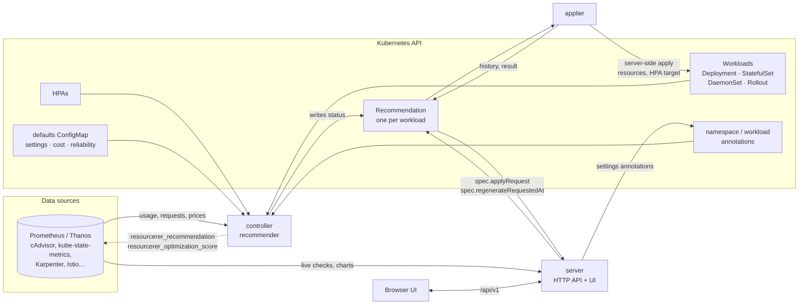
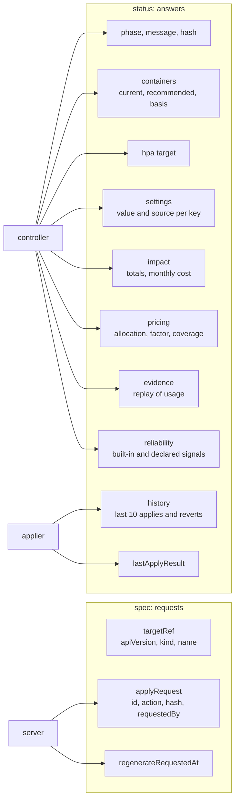
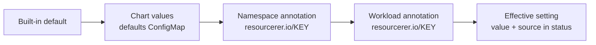
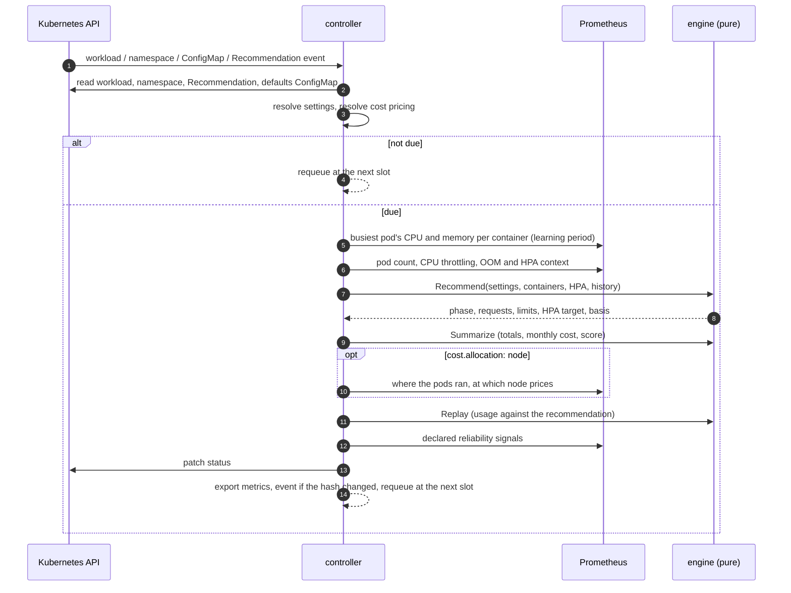
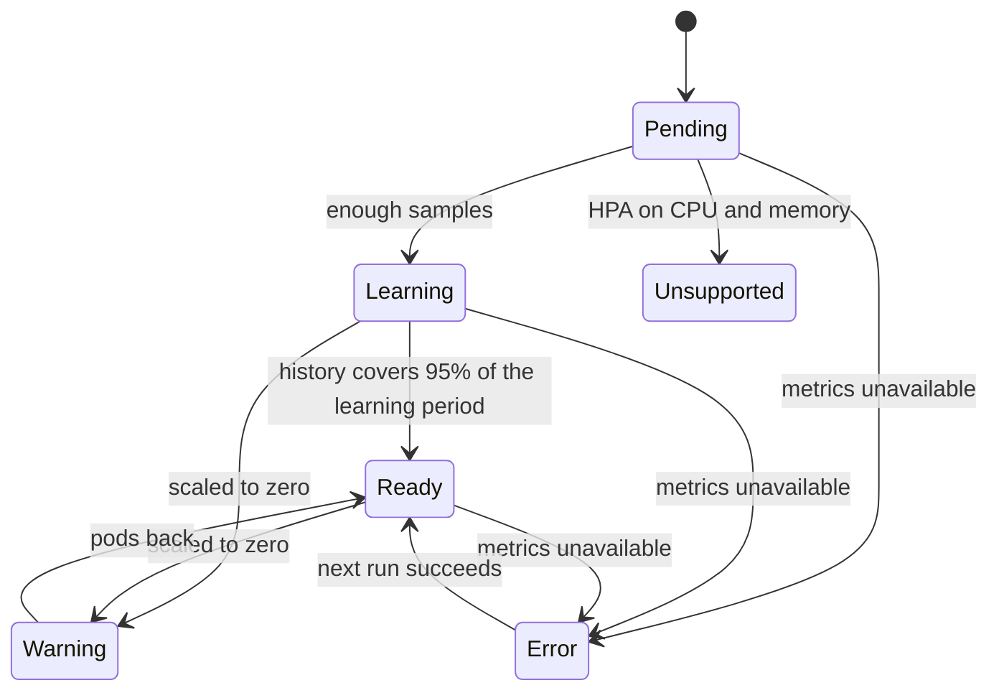
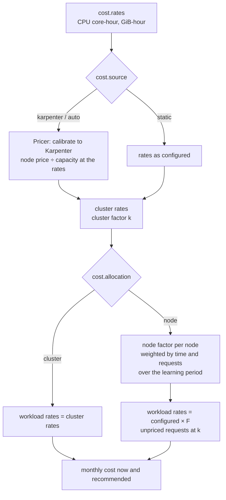
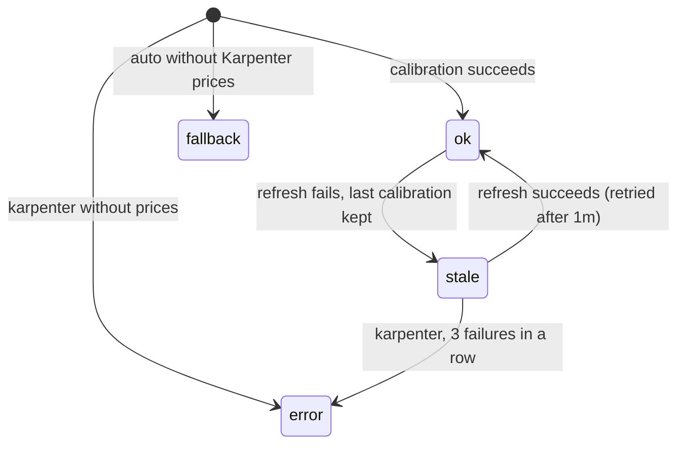
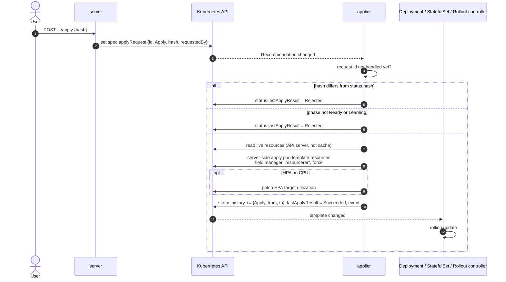
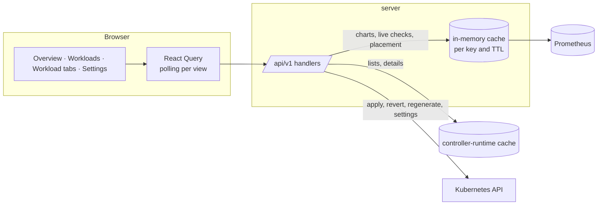
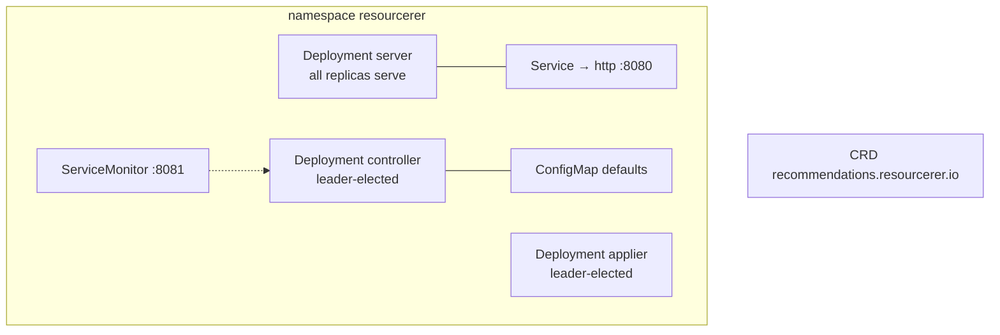

# Architecture

How resourcerer is put together and what happens under the hood: the components, the `Recommendation` resource,
how a recommendation is computed, priced, checked and applied, and how the UI gets its data.

## The big picture

resourcerer is one binary that runs as three components, each its own Deployment in the chart. They never talk to
each other directly: they coordinate through the Kubernetes API, around one custom resource per workload, the
`Recommendation`. Usage history comes from a Prometheus-compatible API that already exists in the cluster
(Prometheus, Thanos, Mimir…); resourcerer keeps no database.

| Component | Watches | Writes | Leader election |
|---|---|---|---|
| **controller** (`internal/recommender`) | Workloads, their HPAs, namespaces, the defaults ConfigMap, Recommendations | `Recommendation` objects and their `status`; Prometheus metrics | yes |
| **applier** (`internal/applier`) | Recommendations | Workload pod templates and HPA targets (server-side apply, field manager `resourcerer`); `status.history`, `status.lastApplyResult` | yes |
| **server** (`internal/server`) | Recommendations, workloads, namespaces, pods (through the cache) | `spec.applyRequest` and `spec.regenerateRequestedAt` on Recommendations; settings annotations on namespaces and workloads | no: every replica serves |

`resourcerer all` runs the three in one process (`make run`). The applier is the only component that changes
workloads, so a read-only install leaves it out and starts the server with `--read-only`.

## The `Recommendation` resource

One per managed workload, named `<kind>-<name>` in the workload's namespace and owned by it (deleted with it).

- **`spec`** is the request side: what to optimize, and requests from the UI (apply, revert, regenerate).
- **`status`** is the answer, written by the controller (recommendation, pricing, evidence, reliability) and the
  applier (history, result).
- **`status.hash`** identifies the recommended values. An apply carries the hash the user reviewed; the applier
  refuses it if the recommendation changed since.

## Which workloads are managed

- `--selection all` (default): every Deployment, StatefulSet, DaemonSet and Argo Rollout, except in excluded
  namespaces and those labeled `resourcerer.io/enabled=false`. `--selection label`: only those labeled
  `resourcerer.io/enabled=true` (on the workload or its namespace).
- A Deployment used by a Rollout through `spec.workloadRef` gets no Recommendation of its own: it is optimized
  through the Rollout, and applies patch that Deployment's template (`status.templateRef`).
- Turning a workload off deletes its Recommendation.

## Settings

Every behaviour that can vary per workload is a setting (`internal/settings`): optimization goals, learning period,
schedule, auto-deploy and its threshold, limits policies and ratios, minimum requests, containers to skip, HPA
handling. They resolve per key, the most specific level winning:

An invalid value is skipped with a warning in the status, so the previous level wins. A change to any level
regenerates the affected recommendations (the controller watches namespaces and the ConfigMap).

## How a recommendation is computed

The controller reconciles each workload kind with its own controller. A reconcile is cheap until the workload is
**due**: its schedule slot passed, a regeneration was requested, its settings or current requests changed, or the
last run failed. Slots are spread over the schedule period by hashing the workload's name, so a cluster does not
query Prometheus all at once.

### The engine (`internal/engine`)

Pure functions over usage series, so every rule is tested with synthetic data.

- **Usage** is the busiest pod per container at each step: the pod that would be throttled or OOM-killed first.
- **Requests** are a percentile of that usage plus a margin, per optimization goal:

  | Goal | CPU | Memory |
  |---|---|---|
  | Savings | p85 + 5% | p99 + 10% |
  | Balanced | p95 + 10% | max + 15% |
  | Reliability | p99 + 20% | max + 30% |

  then raised to the minimum (`cpu.requests.min`, `memory.requests.min`) and rounded.
- **OOM kills** cap the observed memory at the old limit, so the memory recommendation is raised to at least 1.2×
  that limit.
- **Limits** follow the limits policy: keep them (`RequestsOnly`), raise them only if the request would pass them
  (`RequestsRaiseLimitsIfNeeded`), set them at a ratio of the request (`RequestsAndLimits`), or leave the resource
  alone (`DoNotOptimize`). A CPU limit throttling at least 25% of CFS periods is raised by 1.5×, since throttling
  happens in 100ms periods that sampled usage does not show.
- **HPAs**: an HPA scaling on both CPU and memory makes the workload `Unsupported` (changing requests would change
  replica counts). With one on CPU, the target utilization is adjusted so the HPA keeps scaling at the same absolute
  CPU per pod (`hpa.preserve-scale-point`), clamped to 50–90%.
- **Phase**:

  Only `Ready` and `Learning` recommendations can be applied by hand; auto-deploy needs `Ready`.
- **Pending changes**: the recommendation counts as pending when a request moves by more than
  `auto-deploy.threshold` (and a minimum absolute amount), so tiny drifts do not trigger rollouts.

## How costs are priced

Cost is requests × average replicas × hourly rates × 730. The rates come from the `cost` values and the
`Pricer` (`internal/cluster/pricing.go`), and with node allocation each workload gets its own rates.

- **Calibration** scales the configured rates so the priced Karpenter nodes cost what Karpenter's price estimates
  say, keeping the configured CPU-to-memory ratio (node prices do not say how much of them is CPU). It refreshes every
  `cost.karpenter.refreshInterval`.

- **Node allocation** values each pod's requests at the configured rates, multiplies them by the factor of the node
  it ran on (node price ÷ the node's capacity at the same rates; reserved capacity priced as on-demand), and averages
  over the learning period (at most 7 days, 336 points). Requests on nodes without a price count at the cluster
  factor. The result, with the capacity mix and top instance types, is stored in `status.pricing`, and the same
  factor prices both the current and the recommended requests, so savings stay comparable.
- **Placement** (`GET .../placement`) reuses the same queries to show where the workload ran over time, by capacity
  type and instance type, computed on request and cached for 5 minutes.

## Reliability

Signals that requests or limits are too tight, or that the workload is unhealthy for other reasons.

- **Built-in**: CPU throttling, memory peak against the limit, OOM kills, restarts, crash loops, HPA at its maximum,
  BestEffort pods. Computed from Prometheus and pod status.
- **Declared**: PromQL templates in the chart values, evaluated per workload over its learning period
  (`internal/signals`, `docs/reliability-signals.md`). A signal with no data does not apply to the workload; one that
  fails is skipped and never blocks the recommendation.

The controller stores the learning-period view in `status.reliability`, which drives the workload list and the
verdict. The server checks the same signals live (`GET .../reliability?window=15m|1h|6h|1d|learning`), so a fix shows
up as resolved within minutes instead of when old samples leave the learning period.

## Evidence and the verdict

At each regeneration the engine replays the usage history against the recommended requests (`engine.Replay`): the
busiest pod's peak and the share of samples above the recommendation, per resource, and the p95 usage × replicas
priced like the requests (what the workload actually needs). It is stored in `status.evidence`.

The Impact tab turns phase, history coverage, evidence and open reliability signals into a verdict
(`web/src/verdict.ts`): "Safe to apply", "Review before applying", "Apply to fix reliability", "Already
right-sized", or a waiting or error state. Signals the recommendation itself fixes (OOM kills, CPU throttling from
25%, where it raises the limit) count for applying; others ask for a review.

## How a recommendation is applied

- **Auto-deploy**: with `auto-deploy: Enabled`, the applier applies a `Ready`, pending recommendation as
  `auto-deploy`, once per hash; a hash already in the history (applied, or reverted by someone) is never re-applied.
- **Revert** applies the `from` values of the last apply, through the same path.
- **Server-side apply** with the `resourcerer` field manager owns only the resources fields it sets, so GitOps tools
  can ignore them by manager instead of fighting over them.
- The applier remembers handled request IDs and auto-applied hashes in memory, because right after a status patch
  the cache can still serve the old object.

## The server and the UI

- **Endpoints**: `info` (cluster, settings defaults, cost and reliability configuration, Prometheus status),
  `workloads` (list), `workloads/{ns}/{kind}/{name}` (detail) and its `series`, `impact`, `reliability` and
  `placement`, `cluster/series`, and the writes `apply`, `revert`, `regenerate` and `settings`.
- **Lists and details** come from the Recommendations in the cache: no Prometheus query, so they stay fast with
  thousands of workloads.
- **Charts and live checks** query Prometheus on request, cached per key for a short time; concurrent identical
  requests share one query.
- **Writes** go through `s.write`, which refuses them in read-only mode. Authentication is anonymous for now: keep
  the Service internal or put an authenticating proxy in front.
- **The UI** is embedded in the binary (`web.FS()`) and served as a single-page app. React Query polls the workload
  every 5s, the list every 15s and charts every 30s; expensive views fetch only when shown.

## Deployment

- **RBAC** follows the split: the controller reads workloads and writes Recommendations; the applier patches
  workload templates and HPAs; the server reads, and writes Recommendation specs and settings annotations unless
  read-only.
- **Cache footprint**: only the defaults ConfigMap's namespace is cached for ConfigMaps, and managed fields are
  stripped from cached objects, since caching every ConfigMap in a large cluster costs hundreds of MiB.
- **Metrics**: `resourcerer_recommendation{namespace, workload_kind, workload, container, resource, type}` and
  `resourcerer_optimization_score`, scraped through the ServiceMonitor; the charts read recommendation history from
  them.

## Where this is going

The roadmap is in the design issues: reliability signals as custom resources (#28), `ApplyPolicy` for windows,
freezes and verified auto-deploy (#29), `OptimizationPolicy` for settings by selector (#30), `CostProfile` for Savings
Plans and Reserved Instances (#27), and decision models (Jev / decider) behind the verdict (#26).
