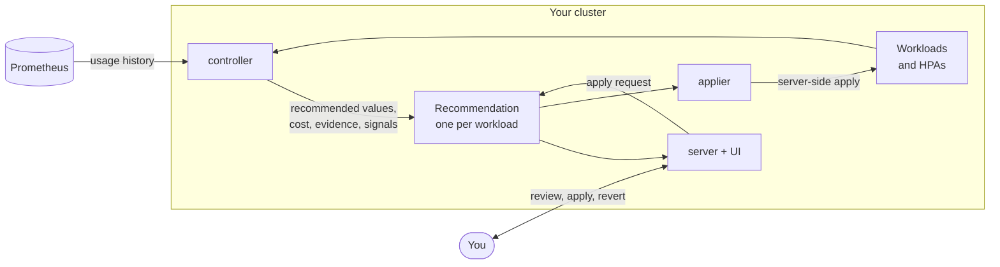

resourcerer is one binary that runs as three components, each its own Deployment. They never call each other: they
coordinate through the Kubernetes API around one custom resource per workload, the `Recommendation`.

| Component | What it does | What it writes |
|---|---|---|
| **controller** | Finds the workloads to manage, resolves their settings, reads their usage from Prometheus and computes the recommendation on each workload's schedule. | `Recommendation` objects; metrics with the recommended values |
| **applier** | Carries out applies and reverts requested from the UI, and auto-deploys where enabled, within the apply policies. | Workload pod templates and HPA targets; the apply history |
| **server** | Serves the UI and the HTTP API, and runs live Prometheus checks for the workload page. | Apply requests on `Recommendation`s; settings annotations |

The applier is the only component that changes workloads. Leave it out (`applier.enabled: false`) and resourcerer only
recommends.

## From usage to a recommendation

On each workload's **schedule** (daily by default, at a time spread per workload so Prometheus is not queried all at
once), the controller:

1. **Resolves the settings** for the workload: chart defaults, then namespace annotations, then workload annotations.
2. **Reads the usage history** over the **learning period** (7 days by default): for each container, the CPU and
   memory of the **busiest pod** at each step, plus OOM kills, CPU throttling and the HPA.
3. **Computes the recommendation**: a percentile of usage plus a margin, per the optimization goal; then minimums,
   rounding, limits per the limits policy, and the HPA target. See [Recommendations](recommendations.md).
4. **Prices it**: the monthly cost of the current and the recommended requests. See [Costs](costs.md).
5. **Replays the history** against the recommendation (the **evidence**) and evaluates the **reliability signals**.
6. **Writes the status** of the `Recommendation`: phase, values with their basis, cost, evidence, signals, and a
   **hash** identifying the recommended values.

A recommendation is also regenerated as soon as its settings change, the workload's requests change, or someone
clicks **Regenerate**.

## From a recommendation to a change

1. You review the workload page: cost before and after, the verdict, the values and their basis, the usage charts.
2. **Apply** records a request on the `Recommendation`, carrying the hash you reviewed.
3. The applier checks the request (the hash still matches, the phase allows it, the apply policies allow it now),
   then patches the pod template's resources with **server-side apply**, under the field manager `resourcerer`, and
   the HPA target when there is one.
4. The workload rolls out as it would on any deploy, following its strategy.
5. The apply goes into the recommendation's history, so **Revert** can put the previous values back.

With **auto-deploy**, the applier does the same without a click, for `Ready` recommendations that changed enough,
once per hash. See [Apply and revert](../guides/apply-and-revert.md).

## Where the data lives

- **Recommendations** are custom resources: `kubectl get recommendations -A` shows the same numbers as the UI.
- **History** stays in Prometheus. The controller exports the recommended values as metrics, which the UI charts.
- **Settings** are chart values and annotations; **apply policies** are custom resources. All of it can live in Git.

There is no database to back up. Under the hood, with sequence diagrams for each flow:
[Architecture](../architecture.md).
