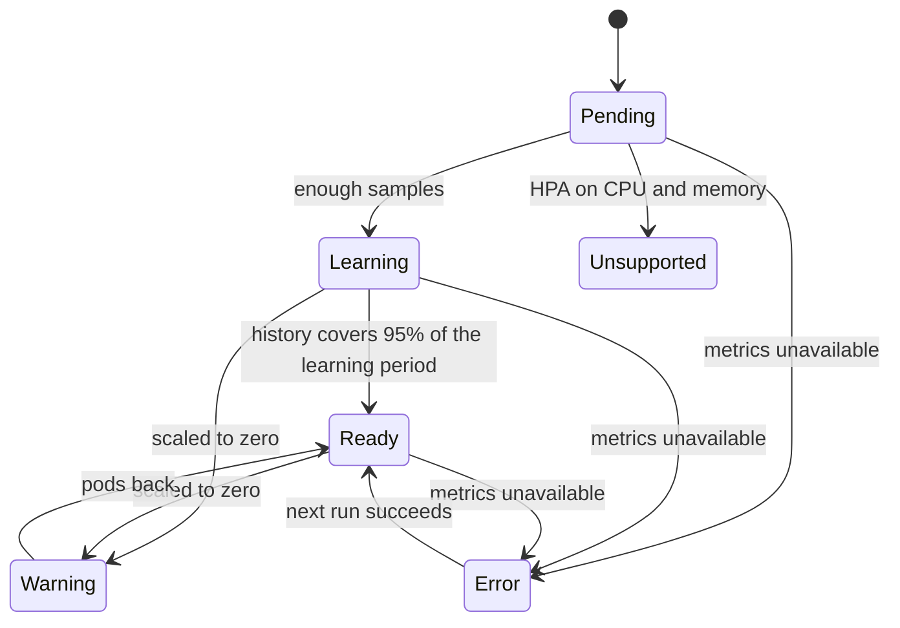

Every `Recommendation` has a **phase**: how far it can be trusted, and whether it can be applied. The workload list
shows it as the status, `kubectl get recommendations` in the `PHASE` column, and the status's `message` says why.

| Phase | Meaning | Apply by hand | Auto-deploy |
|---|---|---|---|
| `Pending` | Not enough samples yet for any recommendation. | No | No |
| `Learning` | A preliminary recommendation: the history does not cover the learning period yet. | Yes, after review | No |
| `Ready` | The history covers at least 95% of the learning period. | Yes | Yes |
| `Warning` | A recommendation exists but cannot be applied now, such as a workload scaled to zero. | No | No |
| `Unsupported` | The workload cannot be optimized, such as an HPA scaling on CPU and memory. | No | No |
| `Error` | Metrics could not be read. | No | No |

## What to do in each phase

**`Pending`** (`Collecting usage history.`): wait. A new workload needs at least 10 samples per container (fewer with a
very short learning period). If it stays `Pending`, check that Prometheus has cAdvisor data for its pods: the
[troubleshooting page](../reference/troubleshooting.md#a-workload-stays-pending) has the queries.

**`Learning`** (`Preliminary: 2d of the 7d learning period collected.`): the values are real but based on less history
than you asked for. Applying is allowed and the verdict says "Review before applying". It becomes `Ready` on its own
as history accumulates; if Prometheus keeps less than the learning period, it never will, so shorten the learning
period or extend retention.

**`Ready`** (`Based on the full learning period.`): review and apply, or let auto-deploy do it.

**`Warning`** (`Scaled to zero: there are no pods to apply to.`): the recommendation is kept from earlier history and
becomes applicable again when pods come back.

**`Unsupported`**: the message names the reason, such as
`HPA checkout scales on CPU and memory utilization, so changing requests would change replica counts.` Change the HPA
to scale on one of them, or leave the workload to its HPA.

**`Error`** (`Metrics unavailable: ...`): the controller could not query Prometheus. The message carries the error;
the next run retries. See [troubleshooting](../reference/troubleshooting.md).

## Pending, the status field

Not to be confused with the phase: a recommendation is **pending** when it differs enough from the current requests to
be worth applying (`status.pending`, see [Recommendations](recommendations.md#when-a-recommendation-counts-as-a-change)).
A `Ready` recommendation that is not pending is "Already right-sized".
