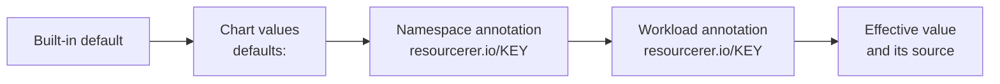

Two kinds of configuration:

- **Chart values** configure the installation: where Prometheus is, which workloads are managed, how costs are
  estimated, reliability signals, apply policies. They are set once per cluster. See [Helm values](../reference/helm-values.md).
- **Settings** configure how each workload is optimized: goals, learning period, schedule, auto-deploy, limits. They
  can differ per namespace and per workload. See [Settings](../reference/settings.md).

## Settings: three levels

A setting resolves per key, the most specific level winning:



```yaml title="values.yaml: cluster defaults"
defaults:
  cpu.optimization-goal: Balanced
  memory.optimization-goal: Balanced
  auto-deploy: Disabled
```

```bash
# A namespace: every workload in it, unless the workload says otherwise.
kubectl annotate namespace payments resourcerer.io/memory.optimization-goal=Reliability

# One workload.
kubectl -n payments annotate deployment checkout resourcerer.io/auto-deploy=Enabled
```

In a manifest, the annotation goes on the workload's own `metadata`, not on its pod template:

```yaml
apiVersion: apps/v1
kind: Deployment
metadata:
  name: checkout
  namespace: payments
  annotations:
    resourcerer.io/memory.optimization-goal: Reliability
    resourcerer.io/auto-deploy: Enabled
```

The workload page's **Settings** tab shows every effective value and where it came from (`cluster`, `namespace` or
`workload`), and lets you change it for the workload or its namespace, which writes the same annotations. The
`Recommendation` stores the same in `status.settings`.

A change at any level regenerates the affected recommendations within seconds. An **invalid value** is ignored with a
warning on the workload page and in `status.warnings`, and the previous level wins, so a typo never breaks a
recommendation.

:::tip[GitOps]
Settings are plain annotations, so they belong in Git with the manifests. If you also change them from the UI, tell
your GitOps tool to ignore `resourcerer.io/*` annotations, or the next sync puts the Git value back. See
[GitOps](../guides/gitops.md).
:::

## The five settings to decide first

Most clusters only need these, set as cluster defaults, with exceptions per namespace.

### 1. Optimization goal

`cpu.optimization-goal` and `memory.optimization-goal`: `Savings`, `Balanced` (default) or `Reliability`. A common
split is `Savings` for non-production namespaces, `Balanced` for production, and `Reliability` for the few workloads
on the critical path. CPU and memory can differ: CPU above the request only slows a container down, memory above the
limit kills it. See [Goals and limits](goals-and-limits.md).

### 2. Learning period

`learning-period` (default `P7D`): how much history a recommendation is computed from. A week covers the weekday and
weekend cycle of most services. Use `P14D` or `P30D` for workloads with a monthly peak, if Prometheus keeps that much.
See [Learning period and schedule](learning-period-and-schedule.md).

### 3. Limits policy

`cpu.limits-policy` and `memory.limits-policy` (default `RequestsRaiseLimitsIfNeeded`): whether limits are kept, raised
only when needed, set at a ratio, or left alone. Match your organization's practice: many teams drop CPU limits and
keep memory limits. See [Goals and limits](goals-and-limits.md#limits-policy).

### 4. Minimums

`cpu.requests.min` (`10m`) and `memory.requests.min` (`16Mi`): the floor under every recommendation. Raise the memory
minimum for runtimes with a large baseline, such as the JVM.

### 5. Auto-deploy

`auto-deploy` (default `Disabled`): the switch that turns recommendations into changes without a click. Turn it on
namespace by namespace once you trust the recommendations, with an apply policy that keeps it to working hours. See
[Roll out auto-deploy](../guides/auto-deploy.md).

## A starting point

```yaml title="values.yaml"
defaults:
  cpu.optimization-goal: Balanced
  memory.optimization-goal: Balanced
  learning-period: P7D
  schedule: "@daily"
  cpu.limits-policy: RequestsRaiseLimitsIfNeeded
  memory.limits-policy: RequestsRaiseLimitsIfNeeded
  memory.requests.min: 32Mi
  auto-deploy: Disabled

applyPolicies:
  cluster:
    - name: business-hours
      spec:
        appliesTo: [Auto]
        windows:
          - { days: [Mon, Tue, Wed, Thu], from: "09:00", to: "16:00", timeZone: Europe/Lisbon }
        rate:
          maxConcurrent: 2
          perNamespace: { maxConcurrent: 1 }
          cooldown: 24h
```

Then, per namespace:

```bash
kubectl annotate namespace dev resourcerer.io/cpu.optimization-goal=Savings resourcerer.io/memory.optimization-goal=Savings resourcerer.io/auto-deploy=Enabled
kubectl annotate namespace payments resourcerer.io/memory.optimization-goal=Reliability
```
