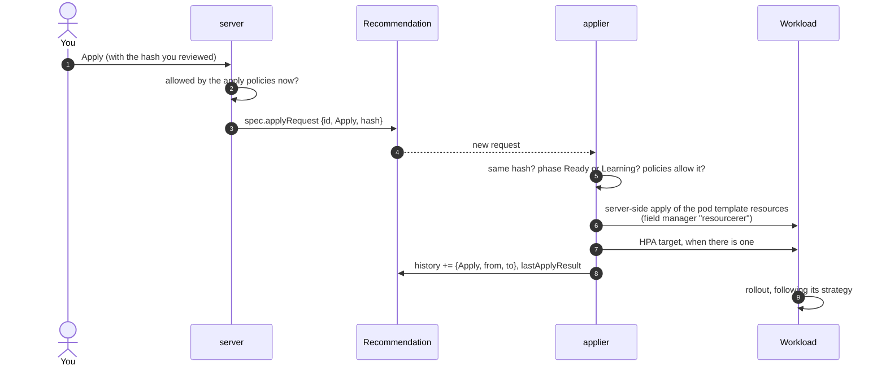

## Before applying

On the workload page, read the verdict under **Apply** and the reasons listed with it. A good first apply:

- is in a namespace where a rollout is cheap, such as staging;
- is `Ready`, with "Safe to apply";
- saves enough to be worth a rollout.

Look at the **Recommendation** tab's charts: the recommended request should sit above most of the usage line for CPU,
and above all of it for memory.

## What Apply does



1. The server checks the apply policies first and answers a held click at once with the reason (HTTP `409`).
2. It records the request on the `Recommendation`, with the hash of what you reviewed.
3. The applier picks it up, reads the workload live from the API server, and patches the **resources of each
   container** in the pod template, and the HPA's target utilization when the recommendation changes it. Nothing else
   in the workload is touched.
4. Changing the pod template starts a **rollout**, exactly as a deploy would: a Deployment's rolling update with its
   `maxSurge` and `maxUnavailable`, a StatefulSet's pods one by one, an Argo Rollout's canary or blue-green steps.
5. The apply goes into `status.history` (the last 10 applies and reverts) with the values before and after, and an
   event `RecommendationApplied` is recorded on the workload.

The UI shows the result within seconds, with an **Undo** right after a successful apply.

## Apply some containers only

When the recommendation changes more than one container of the pod, the apply dialog lists them with a checkbox each,
all selected: **Apply all** applies the whole recommendation, **Apply selected** only the containers left checked.
Containers the recommendation does not change cannot be selected.

Use it to take a change one container at a time, for instance the sidecar whose CPU limit is throttling it today, and
the main container after the next peak:

- The other containers keep their resources, and the recommendation stays pending for them: apply them later, from
  the same dialog.
- A **revert** restores only what the last apply changed.
- **Auto-deploy** does not apply the rest of a recommendation you applied in part: it skips any hash already in the
  history, as after a revert. The next regeneration with different values is a new hash. To have auto-deploy change
  some containers and leave the others to people, see
  [Some containers only](auto-deploy.md#some-containers-only).
- When the recommendation also changes an **HPA's** CPU target, the containers are applied together: the new target
  keeps the HPA scaling at the same CPU per pod only with every container's CPU applied.
- The verdict and the savings on the page count every container, not the selection.

From the API, add the containers to the body: `{"hash": "<status.hash>", "containers": ["worker"]}`.

## Revert

**Revert** puts back the `from` values of the last apply, through the same path: a server-side apply and a rollout. It
is never held by an apply policy: undoing a bad change must stay possible during a freeze or right after the apply.

A reverted recommendation is not re-applied by auto-deploy: auto-deploy skips any hash already in the history. A new
hash, after the next regeneration, can be applied again.

## Why an apply is refused

`status.lastApplyResult` and the UI say why:

| Result | Message | What to do |
|---|---|---|
| `Rejected` | `the recommendation changed since it was reviewed; reload and review it again` | The recommendation was regenerated between your review and the click. Review the new values. |
| `Rejected` | `cannot apply a Warning recommendation` (or another phase) | Only `Ready` and `Learning` recommendations can be applied. |
| `Rejected` | the policy and rule that hold it, such as `outside the apply windows (...)` | An apply policy holds manual applies now. See [Apply policies](apply-policies.md). |
| `Rejected` | `nothing to revert` | There is no apply in the history to undo. |
| `Rejected` | `the workload has no container "…"`, `container "…" is not optimized`, `… apply all containers` | An apply limited to containers named one that does not exist, one in `containers.skip`, or left one out while an HPA target changes. |
| `Failed` | the API server's error | The patch failed, for instance on an admission webhook or a quota. An `ApplyFailed` warning event carries it. |

## Follow an apply from the command line

```bash
# The result of the last request, and the history.
kubectl -n payments get recommendation deployment-checkout -o jsonpath='{.status.lastApplyResult}{"\n"}'
kubectl -n payments get recommendation deployment-checkout -o jsonpath='{range .status.history[*]}{.time} {.action} {.by}{"\n"}{end}'

# Events on the workload: RecommendationGenerated, RecommendationApplied, RecommendationReverted, ApplyDeferred, ApplyFailed.
kubectl -n payments events --for deployment/checkout

# The rollout it started.
kubectl -n payments rollout status deployment/checkout
```

## Who owns the applied values

The applier uses **server-side apply** with the field manager `resourcerer`, forcing ownership of the `resources` of
the containers it changes. (An HPA's CPU target is changed with a plain patch.) That makes the change visible to tools that compare managed fields: Argo CD can ignore it,
and `kubectl apply` from Git overwrites it. See [GitOps](gitops.md) for how to keep the two from fighting.

## Apply from Git instead

The **Patches** tab has the recommendation as a Kustomize patch, Helm values or a `kubectl` command. Commit it like
any other change; the next regeneration sees the new requests and the recommendation becomes "Already right-sized".
